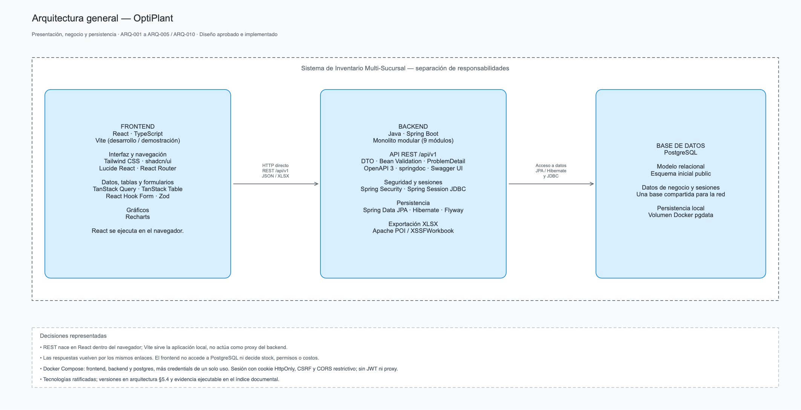

# OptiPlant — Sistema de Inventario Multi-Sucursal

Aplicación web para gestionar de forma centralizada el inventario de una red de sucursales: catálogo, existencias, compras, ventas, transferencias entre sucursales, logística, indicadores y reportes. Resuelve una necesidad concreta: que cada sucursal opere con autonomía local sin que la red pierda una única versión de sus existencias. Por eso todas trabajan sobre una plataforma común, con permisos por sucursal, y un administrador supervisa el conjunto.

Es la solución a la [prueba técnica de OptiPlant Consultores](docs/00-source/prueba-tecnica.pdf). Los 55 requerimientos funcionales (RF-0001–RF-0055) están implementados.

El acceso se organiza en tres perfiles, que limitan tanto las acciones como las sucursales visibles:

| Perfil | Alcance |
|---|---|
| Administrador | Toda la red: configuración, sucursales, usuarios, catálogo, listas de precios, rutas y consulta global. |
| Gerente de sucursal | Su sucursal: supervisa, aprueba transferencias y consulta reportes. |
| Operador de inventario | Su sucursal: movimientos, compras, ventas y solicitud de transferencias. |

## Instalación

Solo se necesita Docker con Compose y Git. Java, Maven, Node y PostgreSQL se ejecutan dentro de contenedores, lo que evita instalaciones locales y reduce las diferencias entre equipos.

```sh
git clone https://github.com/squ-04/optiplant-inventory-system
cd optiplant-inventory-system
docker compose up --build --wait
```

`--build` construye las imágenes y `--wait` devuelve el control cuando los servicios están sanos. La primera construcción puede tardar varios minutos.

No hay configuración previa, como exige el enunciado (§5): el servicio de un solo uso `credentials` genera las credenciales en el primer arranque y las conserva en un volumen. Se prefirió esta solución a fijar valores por defecto en `docker-compose.yml`, porque estos quedarían publicados en el repositorio.

| Servicio | Dirección |
|---|---|
| Aplicación | <http://localhost:5173> |
| API | <http://localhost:8080> |
| Documentación de la API | <http://localhost:8080/swagger-ui/index.html> |

**Primer acceso.** El código es `ADMIN`. La contraseña inicial no se imprime en los registros: se consulta con el comando siguiente, y el primer ingreso exige cambiarla:

```sh
docker compose exec backend cat /run/optiplant/admin-password
```

Usa siempre `localhost`, no `127.0.0.1`: la sesión viaja en cookies y CORS solo admite orígenes explícitos, de modo que ambos dependen de mantener el mismo nombre de host.

**Datos.** `docker compose down` conserva la base. `docker compose down -v` **elimina los datos y las credenciales generadas**.

**Configuración opcional.** Un archivo `.env` permite cambiar puertos y credenciales; sus valores prevalecen sobre los generados. `.env.example` documenta las variables. `python3 scripts/init_environment.py` lo crea con secretos aleatorios.

**Comprobaciones.** `python3 scripts/run_checks.py all` ejecuta las verificaciones del repositorio, la documentación, el backend, el frontend y un arranque de integración aislado. Requiere Python 3.10 o posterior.

Más detalle en [Ejecutar y verificar la base técnica](docs/07-colaboracion/preparacion-tecnica.md).

## Arquitectura

El sistema se compone de tres servicios independientes orquestados por Docker Compose: frontend, backend, construido como monolito modular, y PostgreSQL. El frontend se comunica con el backend exclusivamente por API REST y PostgreSQL no publica puertos al host, de modo que todo acceso a los datos pasa por las validaciones y los permisos del servidor. La interfaz orienta al usuario, pero el backend es quien decide.



| Capa | Tecnología | Responsabilidad |
|---|---|---|
| Presentación | React 19, TypeScript 6, Vite 8, Tailwind CSS 4, shadcn/ui, Recharts 3 | Interfaz web responsiva y dashboards. No decide permisos, existencias, costos ni estados. |
| Negocio | Java 25, Spring Boot 4.1, Spring Security, Apache POI | API REST, reglas de negocio, autorización, cálculo de costos e indicadores, y reportes. |
| Datos | PostgreSQL 17, Spring Data JPA con Hibernate, Flyway | Persistencia relacional y migraciones versionadas: Flyway evoluciona el esquema y Hibernate solo lo valida. |
| Infraestructura | Docker Compose | Servicios aislados, comprobaciones de salud, datos en un volumen y arranque con un solo comando. |

El backend se organiza por funcionalidad (*package-by-feature*), para que cada área del negocio pueda entenderse y revisarse por separado. Dentro de cada módulo, los controladores exponen la API, los servicios concentran reglas y transacciones, y los repositorios acceden a los datos. La colaboración entre módulos usa contratos internos, no repositorios ajenos, e `inventory` es el único propietario de existencias, movimientos y valoración: compras, ventas y transferencias reutilizan esa capacidad en lugar de reimplementarla.

Referencias: [arquitectura y diseño técnico](docs/04-arquitectura/arquitectura-y-diseno-tecnico.md), [modelo de datos y diagramas E-R](docs/06-modelo-base-datos/modelo-datos.md) e [índice de todos los diagramas y documentos](docs/indice-documental.md).

## Módulos implementados

| Módulo | Requerimientos | Funcionalidad |
|---|---|---|
| Identidad y administración (`identity`) | RF-0001–RF-0007 | Configuración, usuarios, sucursales, autenticación y permisos por perfil y sucursal. |
| Catálogo (`catalog`) | RF-0008–RF-0013 | Productos con baja lógica, unidades de medida, stock mínimo y catálogo local. |
| Inventario (`inventory`) | RF-0014–RF-0020 | Consulta entre sucursales, ingresos y retiros trazables, y alertas de reabastecimiento. |
| Compras (`purchases`) | RF-0021–RF-0026 | Proveedores, órdenes con condiciones, recepción, histórico y costo promedio ponderado. |
| Ventas (`sales`) | RF-0027–RF-0031 | Ventas con validación de stock, listas de precios, descuentos y comprobantes. |
| Transferencias (`transfers`) | RF-0032–RF-0039 | Solicitud, preparación, aprobación, despacho, recepción y tratamiento de faltantes. |
| Logística (`logistics`) | RF-0040–RF-0043 | Tiempos estimados y reales, rutas, estados y cumplimiento por sucursal y ruta. |
| Dashboard (`dashboard`) | RF-0044–RF-0049 | Ventas comparadas, rotación, demanda, transferencias, reabastecimiento y comparativa entre sucursales. |
| Reportes exportables (`reports`) | RF-0050–RF-0055 | **Funcionalidad adicional elegida:** Excel `.xlsx` de movimientos, ventas y transferencias por rango de fechas. |

## Decisiones de diseño

El criterio común fue elegir el mecanismo más simple capaz de proteger la integridad del inventario, sin añadir infraestructura que el alcance no justifica. Cada decisión se desarrolla, con alternativas y consecuencias, en el [registro de arquitectura](docs/04-arquitectura/arquitectura-y-diseno-tecnico.md) (ARQ-001–ARQ-010).

### Decisiones técnicas

| Decisión | Elección | Por qué |
|---|---|---|
| Stack (ARQ-001, ARQ-002) | React con TypeScript; Java con Spring Boot; API REST | El tipado estático en ambos extremos hace explícitos estados, cantidades y costos. React permite reutilizar componentes en catálogos, operaciones y dashboards; Java aporta `BigDecimal` y Spring Boot integra el acceso a datos elegido. |
| Arquitectura (ARQ-002, ARQ-008) | Monolito modular de nueve módulos | Una transferencia afecta a documentos, saldos y valoración, y debe confirmarse en una sola transacción. El monolito lo permite sin coordinación entre servicios; los microservicios introducirían despliegues y fallos distribuidos que este alcance no necesita. A cambio, se requiere disciplina para mantener los límites entre módulos. |
| Base de datos (ARQ-003) | PostgreSQL relacional | Productos, sucursales, documentos y movimientos tienen relaciones que deben preservarse, y sus cambios deben confirmarse juntos o rechazarse sin efectos parciales. No se identificó una ventaja de NoSQL que compensara modelar esas relaciones. |
| Autenticación y autorización (ARQ-005) | Spring Security con sesiones en PostgreSQL mediante Spring Session JDBC, cookies `HttpOnly` y CSRF | El proyecto exige revocar accesos y expirar sesiones por inactividad, algo que un JWT validado solo por firma y vencimiento no resuelve. Se reutiliza PostgreSQL, sin añadir Redis. La autorización comprueba acción, recurso y sucursal, de modo que conocer un identificador no concede acceso. |
| Sincronización entre sucursales (ARQ-006) | Una base común y polling REST cada dos segundos con TanStack Query | Una sola fuente de verdad evita reconciliar copias, y cada escritura se valida en el servidor aunque la pantalla esté desactualizada. El polling reutiliza REST sin las conexiones persistentes de SSE o WebSockets, a costa de más solicitudes. El objetivo de cinco segundos no tiene medición formal. |
| Consistencia (ARQ-007) | Transacciones `READ COMMITTED`, bloqueo pesimista e idempotencia | Comprobar y guardar sin protección permitiría que dos operaciones consumieran las mismas unidades. Frente al control optimista, el bloqueo serializa las filas en disputa, a costa de posibles esperas, y la clave `Idempotency-Key` evita que un reintento duplique efectos. |
| Patrones (ARQ-008) | Repository, Service Layer y DTO | Separan acceso a datos, reglas y contrato de la API; los DTO, además, evitan exponer entidades JPA y claves internas. CQRS completo, un bus de eventos o una arquitectura hexagonal estricta se descartaron por sobreingeniería. |
| Precisión e identidad (ARQ-009) | `BigDecimal` y `NUMERIC`; UUID público (`externalId`) sobre claves internas `BIGINT` | Cantidades y costos no admiten los errores de redondeo de `float`, y un identificador público evita exponer secuencias internas. |
| Ejecución (ARQ-004) | Docker Compose con migraciones Flyway | Hace reproducible el arranque desde cero y deja versionada la evolución del esquema. Kubernetes no aporta una necesidad demostrada para esta entrega. |
| Reportes (ARQ-010) | Excel `.xlsx` real generado en el backend con Apache POI | La prueba admite PDF o Excel; se ratificó solo Excel, con un archivo real y no un CSV renombrado (INC-020/D01). Generarlo en el servidor aplica los mismos permisos y filtros que la API y aporta un resultado utilizable fuera del dashboard. |

### Decisiones de alcance frente al enunciado

La prueba deja alternativas abiertas o incluye ejemplos que no son obligatorios. Resolverlos de forma explícita evita presentar suposiciones como requisitos. Estas son las decisiones propias del proyecto:

| Tema | Qué dice la prueba | Decisión | Fuente |
|---|---|---|---|
| Clasificación de rutas | Clasificar rutas «por prioridad, costo o tiempo» (§3.5) | Solo por **prioridad manual** alta, media o baja. Sin tarifas ni optimización; el tiempo se mide aparte. | INC-017/D02 |
| Urgencia en transferencias | Aparece en una historia de usuario de ejemplo (§6.3) | **No se incorpora** en esta versión. Es distinta de la prioridad de ruta, que sí existe. | INC-019/D03 |
| Órdenes de pago | Aparecen en una historia de usuario de ejemplo (§6.3) | **Quedan fuera**: no es una funcionalidad financiera obligatoria. Se conservan las condiciones de compra y el plazo de pago. | INC-019/D01 |
| Sistema externo | Actor opcional que se integra con ERP o punto de venta por API (§6.2) | **Queda excluido**: no se implementan integraciones externas. Esto no afecta a la API REST entre el frontend y el backend. | Requisitos funcionales, sección 1 |
| Administrador en transferencias | La solicitud la genera «la sucursal destino (o un administrador)» (§3.4) | Solo la solicita el **operador de la sucursal destino**. El administrador supervisa, pero no solicita, aprueba ni rechaza por herencia de rol. | RF-0032, H v0.16 |

El detalle está en el [registro de decisiones aprobadas](docs/01-requerimientos/decisiones-aprobadas-optiplant-v1.0.md) y en los [requisitos funcionales](docs/01-requerimientos/requisitos-funcionales.md).

## Uso de inteligencia artificial

La IA fue un componente estructural del desarrollo, utilizado bajo la dirección, las decisiones y la validación del responsable del proyecto. El proceso, los prompts utilizados, la evaluación crítica y la estimación de su participación están en [Uso de inteligencia artificial](docs/09-uso-de-ia/uso-de-inteligencia-artificial.md).

## Resumen

OptiPlant ofrece una plataforma común para operar y supervisar una red de sucursales: del catálogo y las existencias a compras, ventas y transferencias, con indicadores y reportes en Excel. Los 55 requerimientos funcionales están implementados y el sistema arranca con un solo comando.

Su diseño responde a una prioridad: que el inventario siga siendo correcto cuando varias sucursales operan a la vez. De ahí la base común y el backend como única autoridad, porque así no hay copias que reconciliar; el monolito modular, porque las operaciones que cruzan módulos deben confirmarse juntas; y el bloqueo con idempotencia, porque ni la concurrencia ni un reintento deben alterar las existencias. Las sesiones en servidor siguen la misma lógica en seguridad: un acceso debe poder revocarse.

El resultado es una solución deliberadamente sobria. Las alternativas más complejas se descartaron cuando el alcance no las justificaba, y las decisiones sobre lo que el enunciado dejó abierto quedaron registradas. Sus costos también son explícitos, como el mayor número de solicitudes del polling o la disciplina que exigen los límites entre módulos. Esa combinación da al sistema un comportamiento predecible y una base que puede revisarse y evolucionar con criterios documentados.
