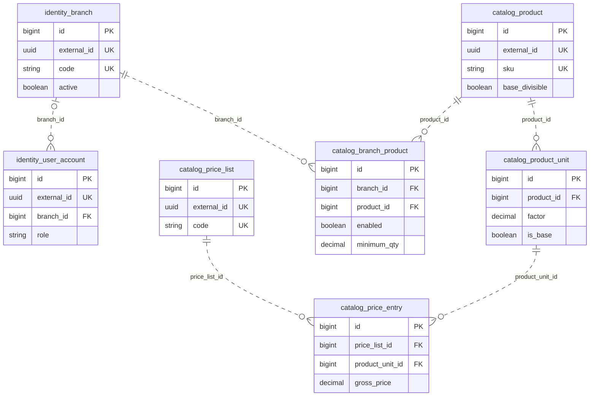
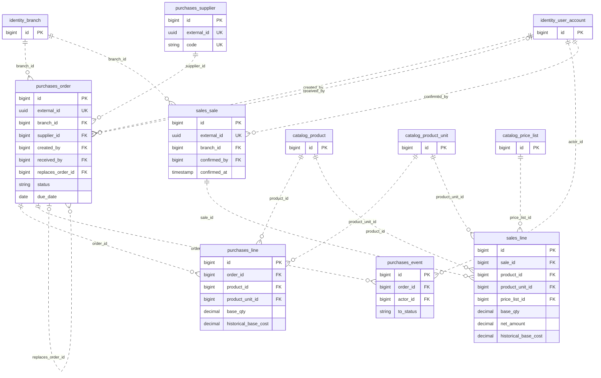
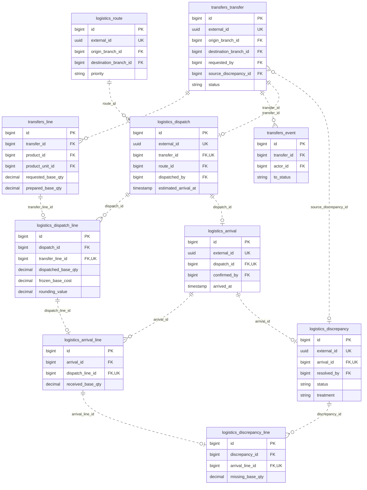
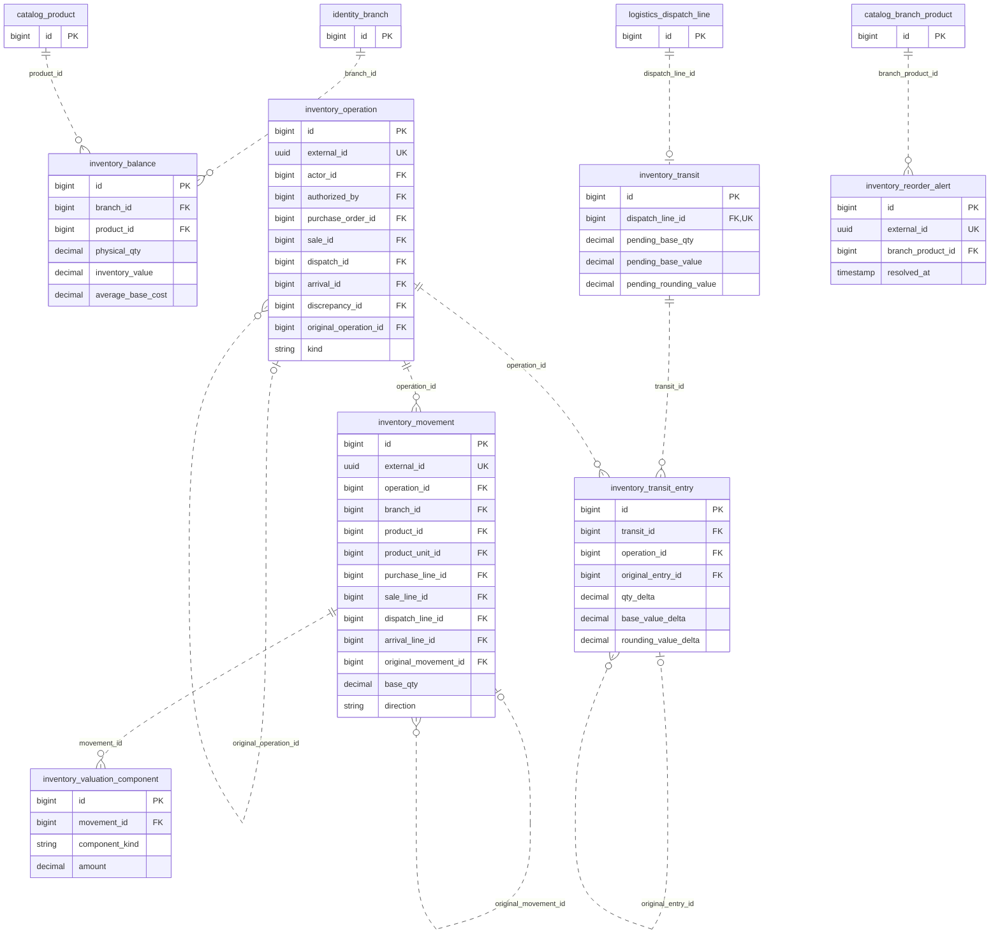
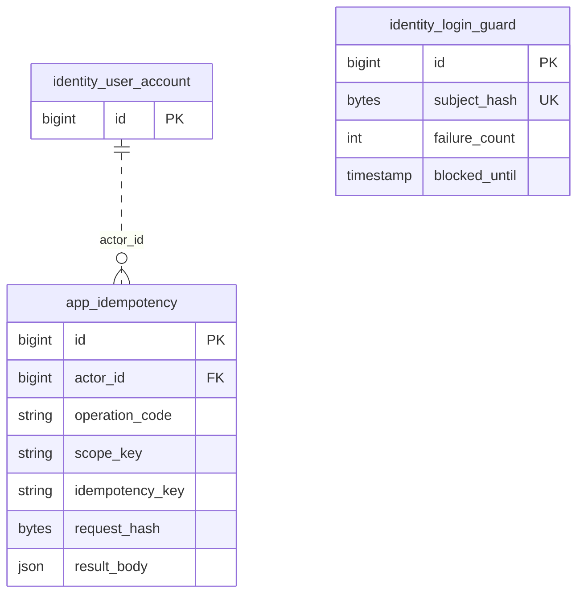
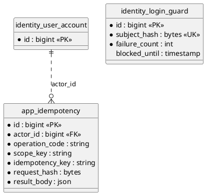

# Modelo relacional y especificación de datos — OptiPlant

**Versión:** 1.1 · **Fecha:** 22 de octubre de 2026 · **Actividad:** sección 7 de la prueba técnica.  
**Estado:** diseño técnico derivado del alcance autorizado; no acredita implementación ni aprobación funcional nueva.  
**Motor objetivo:** PostgreSQL 17.11, una base y esquema compartido `public`. Los prefijos identifican propietarios lógicos, no esquemas ni microservicios.

## 1. Alcance y lectura del documento

Este documento es la referencia técnica del modelo: el diccionario, sus reglas comunes y restricciones complementarias definen atributos y relaciones; los diagramas son proyecciones de ese mismo modelo. Incluye 30 tablas de dominio y dos tablas técnicas propias. No incluye DDL ejecutable, código Java/JPA, migraciones, instalación ni cambios de infraestructura.

Ruta de lectura: fuentes y convenciones (§§2–3), inventario (§4), precisión/tiempo (§5), diccionario (§6), integridad e índices (§§7–8), diagramas (§9), trazabilidad/decisiones (§§10–11) y evidencia de verificación (§12). GitHub representa los bloques `mermaid`; los bloques `plantuml` se conservan como fuente reutilizable, sin renderizado nativo de GitHub.

## 2. Fuentes, vigencia y precedencia

| Clave | Fuente consultada íntegramente | Uso |
|---|---|---|
| E | [PDF original](../00-source/prueba-tecnica.pdf), 9 páginas; [transcripción](../00-source/prueba-tecnica.md) | Obligaciones externas; PDF prevalece ante discrepancias de transcripción |
| RF | [Requisitos funcionales v1.3](../01-requerimientos/requisitos-funcionales.md), incluidos criterios, glosario y correcciones | Comportamiento vigente, RF-0001–RF-0055 |
| D | [Decisiones aprobadas v1.3](../01-requerimientos/decisiones-aprobadas-optiplant-v1.0.md) | INC-003–020, DEC-TEC-ID-001 y H v1.3/01–02; aplicar las sustituciones posteriores expresas de RF |
| R | [RNF](../01-requerimientos/requisitos-no-funcionales.md), [restricciones](../01-requerimientos/restricciones-tecnicas-y-de-negocio.md), [supuestos](../01-requerimientos/supuestos-y-dependencias-del-sistema.md) | Seguridad, precisión, operación y límites |
| UC/HU | [Casos de uso](../02-casos-de-uso/especificacion-casos-de-uso.md), [historias de usuario](../03-historias%20de%20usuario/historias-de-usuario.md) | Trazabilidad de actores y escenarios; no crean alcance independiente |
| A | [Arquitectura v1.1](../04-arquitectura/arquitectura-y-diseno-tecnico.md), [acta arquitectónica](../04-arquitectura/respuestas-decisiones-arquitectura-optiplant.md) | PEN-001–008, ARQ-001–012 y versiones objetivo |
| G | [AGENTS.md](../../AGENTS.md) | Convenciones, español técnico, fuentes protegidas y alcance |
| H | [Guía temporal](../01-requerimientos/incertidumbres-pendientes-temporal.md), índices de diagramas [UC v2](../02-casos-de-uso/diagramas-v2/README.md), [actividad](../05-diagramas-actividad/README.md), [arquitectura](../04-arquitectura/diagramas/README.md) | Antecedentes e índices; no sustituyen decisiones vigentes |

La lectura integral inicial fue realizada mediante exploración documental, seguida de contraste selectivo de arquitectura/PEN y RF numéricos/transferencias. No se trataron escenas Excalidraw como fuentes normativas nuevas. Las correcciones humanas vigentes de RF prevalecen sobre acuerdos anteriores expresamente sustituidos: no hay recepciones sucesivas del mismo despacho, cierre administrativo de la transferencia ni solicitud por administrador. H v1.3/01 sustituye la eliminación física de productos de INC-006/D01 por conservación permanente y baja exclusivamente lógica; H v1.3/02 ratifica la captura del nombre del proveedor en DRAFT y su actualización/congelación al pasar a PENDING. La configuración de UI ya resuelta en PEN no afecta el modelo. La actualización v1.1 sincroniza únicamente estas dos decisiones con las fuentes derivadas autorizadas; el PDF y su transcripción permanecen intactos.

Referencias de ingeniería consultadas, no nuevas decisiones funcionales: [PostgreSQL NUMERIC](https://www.postgresql.org/docs/17/datatype-numeric.html), [tiempo](https://www.postgresql.org/docs/17/datatype-datetime.html), [restricciones](https://www.postgresql.org/docs/17/ddl-constraints.html), [Mermaid ER](https://mermaid.js.org/syntax/entityRelationshipDiagram.html) y [PlantUML IE](https://plantuml.com/ie-diagram).

## 3. Convenciones vinculantes del diseño

### 3.1. Esquema, nombres e identidad

- Todas las tablas siguientes pertenecen a `public`; nombres físicos ingleses `snake_case`, singulares y prefijados por módulo. No se crean nueve esquemas: PEN-005 mantiene `public` común. Los nueve módulos conservan sus contratos internos de PEN-004.
- Toda tabla propia tiene `id BIGINT GENERATED ALWAYS AS IDENTITY`, PK, no nulo, positivo. Las FK son `BIGINT` hacia la PK, salvo que una restricción compuesta de pertenencia añada columnas de contexto. No usar identificadores internos como referencia REST.
- Las tablas marcadas **P** añaden `external_id UUID NOT NULL UNIQUE`, sin valor SQL por defecto; el backend genera UUIDv4 antes de insertar. Validar versión 4 y variante RFC mediante aplicación y `CHECK` sobre la representación UUID (carácter de versión 4 y variante 8/9/a/b). Inmutable. Los códigos/SKU no sustituyen UUID ni PK. Los detalles sin recurso independiente no llevan UUID.
- PK: `pk_<tabla>`; FK: `fk_<tabla>_<columna>`; únicas: `uq_<tabla>_<columnas>`; controles: `ck_<tabla>_<regla>`; índices: `ix_<tabla>_<uso>`. Nombres finales ≤63 bytes; abreviar sin colisiones al implementar.
- Códigos `VARCHAR(64)`: no vacíos, sin espacios extremos; comparación y unicidad exactas, sin imponer mayúsculas ni una equivalencia de negocio no ratificada. Nombres `VARCHAR(160)` y textos `TEXT` salvo longitud explícita. Estos límites son de representación técnica, deben validarse antes de persistir sin truncar.

### 3.2. Cómo leer el diccionario

**NN** = `NOT NULL`; **N** = admite `NULL`; **—** en defecto = ningún valor por defecto. Cada atributo está especificado en las tablas de §6 más las siguientes columnas comunes, que forman parte integral de cada tabla indicada:

| Grupo | Columnas exactas | Aplicación |
|---|---|---|
| I | `id BIGINT` NN, identidad, PK | Las 32 tablas propias |
| P | `external_id UUID` NN, única, generación backend UUIDv4, sin defecto SQL | Solo tablas P del inventario |
| C | `created_at TIMESTAMPTZ` NN, defecto `CURRENT_TIMESTAMP` | Las 32 tablas propias; fecha de inserción, no sustituye fecha del hecho |
| M | `updated_at TIMESTAMPTZ` NN, defecto `CURRENT_TIMESTAMP` | Solo tablas marcadas M; aplicación actualiza al modificar, sin automatismo implícito del defecto |

Las columnas de auditoría no añaden FK implícitas: responsables exigidos están enumerados. Las referencias en el diccionario son FK físicas, no simples asociaciones gráficas. No hay borrados `CASCADE`: todas las FK usan `ON DELETE RESTRICT ON UPDATE RESTRICT`, incluidas las autorreferencias. Una excepción futura requeriría decisión explícita; no se usa `SET NULL` para perder autoría. Los datos confirmados y las filas históricas son inmutables, salvo las proyecciones de estado identificadas. Los borradores podrán eliminar líneas antes de confirmar; no hay permiso general para eliminar documentos.

`NULL` significa ausencia real (p. ej. no ha llegado); cero es un resultado válido (p. ej. llegada con cero unidades). `VARCHAR` de estado utiliza `CHECK` con el conjunto cerrado indicado, no un catálogo modificable ni enum PostgreSQL difícil de evolucionar. Los literales físicos ingleses se traducen a los estados españoles de RF en DTO/UI.

## 4. Inventario y propiedad lógica

| Módulo | Tabla física (`public.` implícito) | Grupos | Clase / finalidad |
|---|---|---|---|
| identity | identity_branch | I/P/C/M | Dominio: sucursal; identidad y activación |
| identity | identity_user_account | I/P/C/M | Dominio: cuenta, rol y adscripción vigente |
| catalog | catalog_product | I/P/C/M | Dominio: producto global |
| catalog | catalog_product_unit | I/C/M | Dominio: unidad y factor específicos de producto |
| catalog | catalog_branch_product | I/C/M | Dominio: habilitación y mínimo explícitos |
| catalog | catalog_price_list | I/P/C/M | Dominio: lista global |
| catalog | catalog_price_entry | I/C/M | Dominio: precio vigente producto/unidad/lista |
| purchases | purchases_supplier | I/P/C/M | Dominio: proveedor mínimo |
| purchases | purchases_order | I/P/C/M | Dominio: orden, recepción única y condiciones |
| purchases | purchases_line | I/C | Dominio: detalle e instantánea de compra |
| purchases | purchases_event | I/C | Dominio: historia de estados de orden |
| sales | sales_sale | I/P/C | Dominio: venta confirmada/comprobante |
| sales | sales_line | I/C | Dominio: detalle histórico de venta |
| transfers | transfers_transfer | I/P/C/M | Dominio: solicitud y estado global |
| transfers | transfers_line | I/C/M | Dominio: cantidades solicitadas/preparadas |
| transfers | transfers_event | I/C | Dominio: historia de estados/responsables |
| logistics | logistics_route | I/P/C/M | Dominio: ruta dirigida/prioridad |
| logistics | logistics_dispatch | I/P/C | Dominio: despacho único por transferencia |
| logistics | logistics_dispatch_line | I/C | Dominio: cantidad/costo congelados |
| logistics | logistics_arrival | I/P/C | Dominio: llegada única incluso cero |
| logistics | logistics_arrival_line | I/C | Dominio: cantidad recibida por línea despachada |
| logistics | logistics_discrepancy | I/P/C/M | Dominio: alerta logística y resolución |
| logistics | logistics_discrepancy_line | I/C | Dominio: faltante histórico por línea |
| inventory | inventory_balance | I/C/M | Dominio: físico y valor por producto/sucursal |
| inventory | inventory_operation | I/P/C | Dominio: hecho confirmado, trazabilidad y compensación |
| inventory | inventory_movement | I/P/C | Dominio: movimiento físico positivo con dirección |
| inventory | inventory_valuation_component | I/C | Dominio: componentes exactos de valoración |
| inventory | inventory_transit | I/C/M | Dominio: saldo de tránsito por línea despachada |
| inventory | inventory_transit_entry | I/C | Dominio: libro de cantidades/valor en tránsito |
| inventory | inventory_reorder_alert | I/P/C/M | Dominio: episodios de alerta por mínimo |
| identity | identity_login_guard | I/C/M | Técnica propia: ventana de fallos/bloqueo de acceso |
| común técnico | app_idempotency | I/C | Técnica propia: arbitraje y resultado de solicitudes |

**Distribución de dominio:** identity 2, catalog 5, inventory 7, purchases 4, sales 2, transfers 3, logistics 7, dashboard 0, reports 0 = **30**. Técnicas propias: identity 1 y común 1 = **2**. Spring Session y Flyway son infraestructura externa y no se incluyen en ese total.

`identity` es dueño de sucursales porque administra adscripciones, activación y ámbito de acceso. Sus bajas consultan invariantes de los módulos mediante contratos; no trasladan inventario a identidad. `inventory` es el único escritor de saldos, movimientos, valoración y tránsito. `transfers` coordina el proceso y llama a `logistics` e `inventory` dentro de una transacción; una FK no autoriza acceso directo a repositorios ajenos. `dashboard` y `reports` leen consultas autorizadas sin duplicar hechos ni crear almacenes de archivos/KPI.

## 5. Precisión, valoración y tiempo

### 5.1. Familias numéricas exactas

Las abreviaturas siguientes son explicaciones, **no tipos SQL nuevos**: en cada atributo se muestra el tipo PostgreSQL exacto. Todo decimal excluye `NaN` y valores no finitos mediante controles explícitos; comparar solo `>= 0` no basta ante `NaN` en PostgreSQL.

| Función | Tipo elegido | Capacidad y motivo |
|---|---|---|
| Cantidad base/comercial, mínimo, saldo | `NUMERIC(18,3)` | 15 enteros y 3 decimales: máximo 999999999999999.999; mínimo positivo 0.001; no es tope comercial ratificado |
| Factor de conversión | `NUMERIC(24,9)` | 15 enteros/9 fraccionarios; permite conversiones pequeñas; validar producto exacto y divisibilidad antes de guardar |
| Precio bruto comercial | `NUMERIC(24,6)` | 18 enteros/6 fraccionarios; no forzar dos decimales por el formato visible |
| Descuento porcentual | `NUMERIC(9,6)` | Rango efectivo 0–100, resolución 0.000001 puntos porcentuales |
| Costo base histórico/congelado/promedio | `NUMERIC(33,6)` | 27 enteros/6 decimales: precio comercial <10^18 dividido por factor mínimo 10^-9 puede alcanzar casi 10^27; costo de compra no negativo, derivados firmados según §5.2 |
| Importe neto comercial exacto | `NUMERIC(51,17)` | 34 enteros/17 decimales: cantidad (15+3), precio (18+6) y descuento/100 (8 fraccionales) producen hasta 17 decimales; 33 enteros bastan para el producto y queda un dígito de margen |
| Valor de inventario/tránsito/componentes | `NUMERIC(60,18)` | 42 enteros/18 decimales; cantidad <10^15 × costo <10^27 <10^42; holgura fraccionaria para reparto y correcciones |

No existe un máximo funcional numérico ratificado. Estas son capacidades técnicas: validar y responder error de representación, sin truncar ni convertir desbordamientos en éxito. Las sumas de muchas líneas o cantidades acumuladas pueden exceder cualquier columna finita: acumular en `BigDecimal` sin precisión global fija y comprobar rango antes de confirmar, con rollback de todo el documento. Los agregados de consulta usan `SUM(NUMERIC)` y no se convierten a tipos menores. La presentación a dos decimales no reduce el valor contable de existencias a centavos.

**Cálculo y cuantización elegidos.** Validar entradas decimales originales antes del cast a `NUMERIC(p,s)`, porque PostgreSQL redondea al asignar. Rechazar cantidades con más de tres decimales significativos, base no representable exactamente o fracciones de unidad indivisible; ceros finales no añaden precisión significativa. Factor con más de nueve decimales, precio con más de seis o descuento con más de seis: rechazar como límite técnico explícito, no redondear silenciosamente. `cantidad_comercial × factor` debe coincidir exactamente con cantidad base y ser representable a tres decimales.

El neto de línea se calcula exactamente `cantidad_comercial × precio_bruto × (1 − descuento/100)` y se almacena a **17 decimales sin redondeo**, sin usar el neto mostrado a dos para valorar. Los operandos admitidos producen como máximo 17 decimales: no hay cuantización intermedia que cambie un posterior HALF_UP a dos. Por ejemplo, 0.001 × 5.000001 × (1 − 0.000020/100) = 0.0049999999999998 se muestra 0.00, no 0.01. Para compra, el costo base se calcula desde precio y descuento, dividido por factor; se cuantiza a seis HALF_UP y se conserva como costo histórico. La precisión de división de trabajo debe permitir decidir correctamente el séptimo decimal: preferir división directa con escala 6/HALF_UP, no doble redondeo. Si una división por cantidad produce promedio, aplicar igualmente escala 6/HALF_UP al resultado final.

Valor de entrada = cantidad base × costo histórico de seis decimales; almacenar a 18 (producto requiere como máximo nueve). El valor de inventario es la suma histórica de componentes, **no** `saldo × promedio redondeado`. Al entrar con saldo previo positivo: `(valor_previo + valor_entrada) / cantidad_nueva`, seis decimales HALF_UP; con saldo previo cero, adoptar costo de entrada. Las salidas ordinarias usan promedio vigente sin recalcularlo por la mera salida. Mantener promedio anterior al agotarse para trazabilidad; próxima entrada con saldo cero lo sustituye.

### 5.2. Componentes y conservación del valor

Cada movimiento físico tiene un componente `BASE` firmado. Puede añadir `FINAL_ROUNDING` (última salida ordinaria) o `HISTORICAL_CORRECTION` (compensación que agota), de importe firmado, nunca una falsa cantidad física cero. Un componente de diferencia cero se omite. La cantidad del movimiento siempre es positiva; dirección define el signo físico, importe del componente define el signo económico.

- Última salida ordinaria: `BASE = −cantidad × promedio`; `FINAL_ROUNDING = −valor_previo − BASE`; suma deja cantidad/valor cero. No cambia precio/importe de venta ni costo unitario congelado.
- Corrección vinculada de entrada: `BASE = −cantidad_corregida × costo_histórico`. Si queda cantidad positiva, recalcular promedio desde valor corregido/cantidad. Si cantidad final cero, `HISTORICAL_CORRECTION = −valor_previo − BASE`. No llamar redondeo a esa diferencia.
- **Valor derivado firmado, físico no negativo.** RF prohíbe físico negativo, no establece un piso general de valoración económica. La aplicación debe conservar el resultado firmado de las fórmulas aprobadas, incluso si una salida al promedio redondeado o una corrección histórica deja valor negativo con cantidad positiva. No normalizar a cero, rechazar por signo económico, inventar una merma ni añadir una diferencia fuera de las reglas de agotamiento. Promedio recalculado, costo de salida congelado y valores derivados admiten signo; los precios de compra/venta ingresados siguen siendo no negativos. Ver ejemplos y consecuencias en §11.3.
- Despacho: tránsito incorpora **todo** el valor retirado del origen, incluido residual separado. Una llegada parcial transfiere el componente base según cantidad y reparte el residual congelado proporcionalmente con escala 18/HALF_UP; conserva el resto exacto. La última liberación del tránsito consume el residual restante. Guardar base y diferencia separados en cada asiento evita perder/duplicar valor. El costo unitario congelado no se altera para absorberlo. Si destino estaba vacío, adopta ese costo; su valor registrado puede incluir residual separado.
- Devolución de venta: costo histórico de la salida y referencia a línea vendida; no reembolso financiero. Los componentes de absorción originales se conservan y solo se revierten proporcionalmente si forman parte del valor efectivamente devuelto, sin sobrepasar el valor/cantidad original acumulados. No recalcular ventas pasadas.

| Caso RF-0026 | Resultado que el modelo conserva |
|---|---|
| 3 unidades / valor 10 / promedio 3.333333; dos salidas de 1 | Valor restante 3.333334; última base −3.333333 y diferencia −0.000001; saldo/valor 0/0 |
| Saldo 8/120, corregir 2 a costo histórico 10 | Base −20, saldo 6/100, promedio 16.666667 |
| Mismo saldo, conteo sin origen de −2 | Base −30, saldo 6/90, promedio 15 |
| Tras vender otras 6 a 15: saldo 2/30; corregir 2 a 10 | Base −20 y diferencia histórica −10; saldo/valor 0/0 |
| Despacho 10 a 9, llegada 7, sin residual | Destino +7/+63; tránsito 3/27 |

### 5.3. Instantes, fechas y calendario

`TIMESTAMPTZ` representa instantes; PostgreSQL conserva el instante, no el nombre de zona original. Persistencia y transporte normalizados a UTC; Java `Instant`. `America/Bogota` interpreta fechas, vencimientos y agrupaciones comerciales. `DATE` para vencimiento de compra; no almacenar una hora local sin zona en `TIMESTAMP` para eventos. Estimación de llegada es un instante obligatorio, convertido desde la captura local de Bogotá; no comparar con un texto ni con medianoche implícita. El tiempo del hecho y `created_at` son diferentes.

Filtros de fechas inclusivas: `[inicio 00:00 America/Bogota, día posterior al fin 00:00 America/Bogota)`, convertidos a instantes. Para hasta 12 meses, intervalo de fechas semiabierto con fin exclusivo ≤ inicio + 12 meses calendario; validar antes de consultar. Definición técnica del borde, no 365 días arbitrarios. Vencimiento = fecha de recepción en Bogotá + plazo entero en días. Fecha de solicitud para reporte de transferencias, confirmación para ventas, registro del hecho para movimientos. Ordenar hechos empatados por `occurred_at, id`; el segundo criterio no sustituye fecha de negocio.

## 6. Diccionario de datos completo

Todos los nombres de tabla y referencias de esta sección usan `public`. Aplican columnas comunes de §3.2 y tipos/signos de §5. Cada FK no nula obliga a exactamente un padre; cada FK nullable admite cero o uno. Un padre admite cero o muchos hijos salvo `UNIQUE` explícita (cero o uno). La obligatoriedad de **al menos una línea al confirmar** es transaccional; los borradores pueden tener cero. Esta distinción se refleja en los diagramas con cardinalidades físicas `0..N`.

### 6.1. identity

#### identity_branch — I/P/C/M

| Atributo | Tipo PostgreSQL | Nulabilidad / defecto | Clave, significado y regla |
|---|---|---|---|
| code | VARCHAR(64) | NN / — | UNIQUE global, inmutable y no reutilizable; incluye inactivas |
| name | VARCHAR(160) | NN / — | Nombre no vacío, editable |
| active | BOOLEAN | NN / TRUE | Baja lógica, no borrado físico |

Sin dirección/contacto inventados. Baja bloquea según stock, documentos y tránsito (§7), no simplemente por la etiqueta histórica de discrepancia.

#### identity_user_account — I/P/C/M

| Atributo | Tipo PostgreSQL | Nulabilidad / defecto | Clave, significado y regla |
|---|---|---|---|
| code | VARCHAR(64) | NN / — | UNIQUE, acceso/identificación de negocio; no reutilizable |
| full_name | VARCHAR(160) | NN / — | Obligatorio, no vacío |
| password_hash | VARCHAR(255) | NN / — | Hash adaptativo codificado; nunca contraseña clara |
| role | VARCHAR(16) | NN / — | CHECK ADMIN, MANAGER, OPERATOR; exactamente uno |
| branch_id | BIGINT | N / — | FK identity_branch; obligatorio para MANAGER/OPERATOR |
| active | BOOLEAN | NN / TRUE | Sin eliminación física |
| credentials_version | BIGINT | NN / 0 | ≥0; incrementa en revocación/cambio sensible, invalida sesiones anteriores |
| must_change_password | BOOLEAN | NN / TRUE | Contraseña temporal/inicial pendiente de cambio; persiste entre sesiones y bloquea operaciones hasta completar el cambio |

CHECK de rol/sucursal: `role = ADMIN OR branch_id IS NOT NULL`. No impone que administrador esté adscrito. El cambio de adscripción no mueve documentos ni reemplaza responsables históricos. Contraseña ingresada de 15–128 caracteres según PEN-001; esos límites aplican a entrada, no al hash. Mientras must_change_password sea TRUE, autenticar solo permite el flujo de cambio y salida, no operar. Cambiar credencial válida actualiza hash, pone el indicador FALSE e incrementa credentials_version atómicamente; emitir sesión renovada o exigir autenticación nueva. Una nueva credencial temporal vuelve a marcar TRUE. Cerrar y abrir sesión nunca elimina esta obligación (RF-0007, INC-003/D10, PEN-001).

### 6.2. catalog

#### catalog_product — I/P/C/M

| Atributo | Tipo PostgreSQL | Nulabilidad / defecto | Clave, significado y regla |
|---|---|---|---|
| sku | VARCHAR(64) | NN / — | UNIQUE global; protegido tras uso |
| name | VARCHAR(160) | NN / — | Nombre comercial no vacío |
| description | TEXT | N / — | Descripción opcional |
| base_unit_name | VARCHAR(64) | NN / — | Nombre de unidad base, inmutable tras uso |
| base_divisible | BOOLEAN | NN / — | Explícito; si falso cantidades base enteras |
| active | BOOLEAN | NN / TRUE | Disponibilidad global; eliminación exclusivamente lógica mediante FALSE, sujeta a ausencia de stock/pendientes |

Todos los productos se conservan permanentemente: no se permite borrado físico, tengan o no referencias, movimientos o dependencias. La eliminación se expresa solo como `active=FALSE`, con físico global cero y sin operaciones/tránsito pendientes; se mantienen las reglas de habilitación local y reactivación. Unidad base embebida evita FK circular producto↔unidad; cada producto tiene además una fila de `catalog_product_unit` con `is_base=TRUE`, factor 1 y nombre/divisibilidad concordantes. No hay catálogo universal de conversiones.

#### catalog_product_unit — I/C/M

| Atributo | Tipo PostgreSQL | Nulabilidad / defecto | Clave, significado y regla |
|---|---|---|---|
| product_id | BIGINT | NN / — | FK catalog_product |
| name | VARCHAR(64) | NN / — | UNIQUE(product_id,name), no vacío |
| factor | NUMERIC(24,9) | NN / — | Finito >0, unidades base por unidad comercial |
| divisible | BOOLEAN | NN / — | Admite fracción comercial solo si true |
| is_base | BOOLEAN | NN / FALSE | CHECK si true: factor=1; única base mediante índice parcial |
| active | BOOLEAN | NN / TRUE | Retirar unidad de nuevas operaciones sin borrar historia |

UNIQUE(id,product_id) soporta FK compuesta de pertenencia. Factor editable para futuro; las instantáneas antiguas no cambian. Existencia de una y solo una unidad base por producto y concordancia con columnas base: transacción de catálogo.

#### catalog_branch_product — I/C/M

| Atributo | Tipo PostgreSQL | Nulabilidad / defecto | Clave, significado y regla |
|---|---|---|---|
| branch_id | BIGINT | NN / — | FK identity_branch |
| product_id | BIGINT | NN / — | FK catalog_product |
| enabled | BOOLEAN | NN / — | Estado local explícito, no derivado de saldo |
| minimum_qty | NUMERIC(18,3) | N / — | Finito ≥0 cuando definido; sin defecto automático |

UNIQUE(branch_id,product_id); CHECK `NOT enabled OR minimum_qty IS NOT NULL`. Al desactivar globalmente un producto, deshabilitar sus filas locales y establecer mínimo NULL en la misma transacción; conservar fila para referencias. Reactivar producto no reconstituye mínimo/habilitación. Nueva habilitación exige mínimo explícito, incluso cero, sin crear saldo. La configuración local no es una existencia.

#### catalog_price_list — I/P/C/M

| Atributo | Tipo PostgreSQL | Nulabilidad / defecto | Clave, significado y regla |
|---|---|---|---|
| code | VARCHAR(64) | NN / — | UNIQUE global |
| name | VARCHAR(160) | NN / — | Nombre no vacío |
| active | BOOLEAN | NN / TRUE | Lista global, no por sucursal |

#### catalog_price_entry — I/C/M

| Atributo | Tipo PostgreSQL | Nulabilidad / defecto | Clave, significado y regla |
|---|---|---|---|
| price_list_id | BIGINT | NN / — | FK catalog_price_list |
| product_unit_id | BIGINT | NN / — | FK catalog_product_unit; producto se obtiene por unidad |
| gross_price | NUMERIC(24,6) | NN / — | Finito ≥0, por unidad comercial, COP |

UNIQUE(price_list_id,product_unit_id); no duplicar `product_id` derivable. Modificar precio no reexpresa ventas; no se necesita catálogo completo de versiones por la instantánea confirmada.

### 6.3. purchases

#### purchases_supplier — I/P/C/M

| Atributo | Tipo PostgreSQL | Nulabilidad / defecto | Clave, significado y regla |
|---|---|---|---|
| code | VARCHAR(64) | NN / — | UNIQUE |
| name | VARCHAR(160) | NN / — | Nombre no vacío; sin identificación fiscal/contactos obligatorios |
| active | BOOLEAN | NN / TRUE | Evitar nuevas selecciones sin destruir historial |

#### purchases_order — I/P/C/M

| Atributo | Tipo PostgreSQL | Nulabilidad / defecto | Clave, significado y regla |
|---|---|---|---|
| code | VARCHAR(64) | NN / — | UNIQUE, número de negocio independiente |
| branch_id | BIGINT | NN / — | FK identity_branch; sucursal documental inmutable al confirmar |
| supplier_id | BIGINT | NN / — | FK purchases_supplier |
| supplier_name_snapshot | VARCHAR(160) | NN / — | Nombre vigente del proveedor capturado al crear DRAFT; actualizado al pasar a PENDING y congelado desde esa transición |
| status | VARCHAR(16) | NN / DRAFT | DRAFT, PENDING, RECEIVED, CANCELLED |
| created_by | BIGINT | NN / — | FK identity_user_account |
| payment_term_days | INTEGER | NN / — | CHECK ≥0; cero explícito |
| received_at | TIMESTAMPTZ | N / — | Instante de única recepción completa |
| received_by | BIGINT | N / — | FK identity_user_account |
| due_date | DATE | N / — | Fecha calculada desde recepción Bogotá |
| replaces_order_id | BIGINT | N / — | FK purchases_order; reemplazo de orden cancelada, distinto de sí misma |

CHECK: RECEIVED implica received_at/received_by/due_date no nulos y viceversa. **Nombre histórico del proveedor:** al crear una orden en DRAFT, capturar el nombre vigente del proveedor asociado en `supplier_name_snapshot`, siempre NOT NULL y no vacío. Al pasar de DRAFT a PENDING, actualizarlo con el nombre vigente del proveedor en la misma transacción que confirma la transición y registra su evento. Desde PENDING queda congelado, incluso si luego la orden pasa a RECEIVED o CANCELLED; renombrar el proveedor no actualiza órdenes existentes ni sus instantáneas. Una orden cancelada desde DRAFT conserva la captura inicial. La FK `supplier_id` mantiene la identidad del proveedor; no sustituye el nombre histórico por una consulta al catálogo actual. Un pedido pendiente no cambia líneas: cancelar y crear reemplazo. No contabilizar pagos/cuentas por pagar. Historia de estados en tabla siguiente; validar plazo y suma de fecha sin desbordamiento.

#### purchases_line — I/C

| Atributo | Tipo PostgreSQL | Nulabilidad / defecto | Clave, significado y regla |
|---|---|---|---|
| order_id | BIGINT | NN / — | FK purchases_order |
| line_no | INTEGER | NN / — | >0; UNIQUE(order_id,line_no) |
| product_id | BIGINT | NN / — | FK catalog_product |
| product_unit_id | BIGINT | NN / — | FK compuesta (product_unit_id,product_id) → catalog_product_unit(id,product_id) |
| sku_snapshot | VARCHAR(64) | NN / — | SKU histórico |
| product_name_snapshot | VARCHAR(160) | NN / — | Nombre histórico |
| unit_name_snapshot | VARCHAR(64) | NN / — | Unidad comercial histórica |
| factor_snapshot | NUMERIC(24,9) | NN / — | >0, finito |
| commercial_qty | NUMERIC(18,3) | NN / — | >0, finito |
| base_qty | NUMERIC(18,3) | NN / — | >0; igualdad exacta con comercial × factor |
| gross_unit_price | NUMERIC(24,6) | NN / — | ≥0, finito |
| discount_pct | NUMERIC(9,6) | NN / — | Entre 0 y 100; cero explícito |
| net_amount | NUMERIC(51,17) | NN / — | ≥0, exacto según §5 |
| historical_base_cost | NUMERIC(33,6) | N / — | ≥0, finito; obligatorio al recibir y congelado entonces |

Instantáneas fijadas al comprometer orden pendiente, costo de inventario al recibir. Los cambios de factor posteriores no alteran esta compra. Unicidad documental no impide líneas legítimas de mismo producto con distintas condiciones; operación de recepción incluye todas.

#### purchases_event — I/C

| Atributo | Tipo PostgreSQL | Nulabilidad / defecto | Clave, significado y regla |
|---|---|---|---|
| order_id | BIGINT | NN / — | FK purchases_order |
| sequence_no | INTEGER | NN / — | >0, UNIQUE(order_id,sequence_no) |
| from_status | VARCHAR(16) | N / — | NULL solo en creación; mismos estados de orden |
| to_status | VARCHAR(16) | NN / — | Estado resultante, mismo CHECK de estados |
| actor_id | BIGINT | NN / — | FK identity_user_account |
| occurred_at | TIMESTAMPTZ | NN / — | Instante del cambio |
| reason | TEXT | N / — | Motivo si corresponde; no imponer dato funcional nuevo |

Historia append-only. Transiciones DRAFT→PENDING/CANCELLED; PENDING→RECEIVED/CANCELLED; inicial NULL→DRAFT. Bloquear orden, validar transición e insertar evento y estado en la misma transacción.

### 6.4. sales

#### sales_sale — I/P/C

| Atributo | Tipo PostgreSQL | Nulabilidad / defecto | Clave, significado y regla |
|---|---|---|---|
| code | VARCHAR(64) | NN / — | UNIQUE, comprobante de negocio; no reutilizar |
| branch_id | BIGINT | NN / — | FK identity_branch |
| confirmed_by | BIGINT | NN / — | FK identity_user_account; responsable histórico |
| confirmed_at | TIMESTAMPTZ | NN / — | Fecha de confirmación/reporte |

Solo se persisten ventas confirmadas; captura fallida no deja venta parcial. No tabla de cliente obligatoria, pago, factura fiscal ni devolución financiera. Total exacto = suma de líneas, presentación HALF_UP a dos; no sumar importes de presentación para valoración.

#### sales_line — I/C

| Atributo | Tipo PostgreSQL | Nulabilidad / defecto | Clave, significado y regla |
|---|---|---|---|
| sale_id | BIGINT | NN / — | FK sales_sale |
| line_no | INTEGER | NN / — | >0; UNIQUE(sale_id,line_no) |
| product_id | BIGINT | NN / — | FK catalog_product |
| product_unit_id | BIGINT | NN / — | FK compuesta unidad/producto → catalog_product_unit |
| price_list_id | BIGINT | NN / — | FK catalog_price_list |
| list_name_snapshot | VARCHAR(160) | NN / — | Lista elegida; no precio libre |
| sku_snapshot | VARCHAR(64) | NN / — | SKU histórico |
| product_name_snapshot | VARCHAR(160) | NN / — | Nombre histórico |
| unit_name_snapshot | VARCHAR(64) | NN / — | Unidad histórica |
| factor_snapshot | NUMERIC(24,9) | NN / — | Finito >0 |
| commercial_qty | NUMERIC(18,3) | NN / — | Finito >0 |
| base_qty | NUMERIC(18,3) | NN / — | >0, igualdad exacta conversión |
| gross_unit_price | NUMERIC(24,6) | NN / — | ≥0, copia precio de lista vigente en confirmación |
| discount_pct | NUMERIC(9,6) | NN / — | 0–100, explícito |
| net_amount | NUMERIC(51,17) | NN / — | ≥0, exacto según §5 |
| historical_base_cost | NUMERIC(33,6) | NN / — | Firmado, promedio de salida conservado para devolución |

Descuento no altera costo de inventario. La devolución se modela como `inventory_operation`/movimiento que refiere esta línea y la salida original. No se cambia esta venta.

### 6.5. transfers

#### transfers_transfer — I/P/C/M

| Atributo | Tipo PostgreSQL | Nulabilidad / defecto | Clave, significado y regla |
|---|---|---|---|
| code | VARCHAR(64) | NN / — | UNIQUE, código de negocio |
| origin_branch_id | BIGINT | NN / — | FK identity_branch |
| destination_branch_id | BIGINT | NN / — | FK identity_branch, distinto de origen |
| requested_by | BIGINT | NN / — | FK identity_user_account; operador destino autorizado |
| requested_at | TIMESTAMPTZ | NN / — | Fecha de solicitud y reporte |
| status | VARCHAR(24) | NN / REQUESTED | REQUESTED, PREPARING, APPROVED, IN_TRANSIT, RECEIVED_COMPLETE, RECEIVED_DISCREPANCY, CANCELLED, REJECTED |
| source_discrepancy_id | BIGINT | N / — | FK logistics_discrepancy; nueva transferencia vinculada a faltante, no segunda llegada |

Origen/destino y cantidades solicitadas se conservan; estado actual es una proyección de eventos. No estado CLOSED ni prioridad de urgencia. Una nueva transferencia vinculada no liquida automáticamente tránsito original.

#### transfers_line — I/C/M

| Atributo | Tipo PostgreSQL | Nulabilidad / defecto | Clave, significado y regla |
|---|---|---|---|
| transfer_id | BIGINT | NN / — | FK transfers_transfer |
| line_no | INTEGER | NN / — | >0; UNIQUE(transfer_id,line_no) |
| product_id | BIGINT | NN / — | FK catalog_product |
| product_unit_id | BIGINT | NN / — | FK compuesta unidad/producto → catalog_product_unit |
| sku_snapshot | VARCHAR(64) | NN / — | SKU conservado |
| product_name_snapshot | VARCHAR(160) | NN / — | Nombre conservado |
| unit_name_snapshot | VARCHAR(64) | NN / — | Unidad conservada |
| factor_snapshot | NUMERIC(24,9) | NN / — | >0, finito; se congela con solicitud |
| requested_commercial_qty | NUMERIC(18,3) | NN / — | >0 |
| requested_base_qty | NUMERIC(18,3) | NN / — | >0, conversión exacta |
| prepared_commercial_qty | NUMERIC(18,3) | N / — | ≥0; NULL = aún sin preparar |
| prepared_base_qty | NUMERIC(18,3) | N / — | ≥0 y ≤ solicitado; ambos preparados NULL o ambos definidos |

UNIQUE(transfer_id,product_unit_id): una línea por producto/unidad, normalizar repeticiones antes de insertar. Igualdad exacta solicitado/comercial/factor y preparado/comercial/factor. Despachado y recibido no sobrescriben estas cantidades: están en logistics. Preparar no reserva stock. Valores preparados mutables solo en preparación; eventos guardan instantánea de revisión (§6.5 siguiente).

#### transfers_event — I/C

| Atributo | Tipo PostgreSQL | Nulabilidad / defecto | Clave, significado y regla |
|---|---|---|---|
| transfer_id | BIGINT | NN / — | FK transfers_transfer |
| sequence_no | INTEGER | NN / — | >0; UNIQUE(transfer_id,sequence_no) |
| from_status | VARCHAR(24) | N / — | NULL solo evento inicial; CHECK estados transferencia |
| to_status | VARCHAR(24) | NN / — | CHECK estados transferencia; puede repetir PREPARING al ajustar preparación |
| actor_id | BIGINT | NN / — | FK identity_user_account |
| occurred_at | TIMESTAMPTZ | NN / — | Fecha del evento |
| reason | TEXT | N / — | Obligatorio no vacío en rechazo y cancelación tras aprobación |
| preparation_snapshot | JSONB | N / — | Solo revisiones de preparación: arreglo de line_no/cantidad comercial/base; esquema validado aplicación |

JSONB no sustituye líneas ni es FK: instantánea de auditoría de versiones previas, no fuente de cantidades actuales. Decisión proporcional frente a otra tabla de revisiones. Validar transiciones y actores bajo bloqueo (§7). Historia append-only.

### 6.6. logistics

#### logistics_route — I/P/C/M

| Atributo | Tipo PostgreSQL | Nulabilidad / defecto | Clave, significado y regla |
|---|---|---|---|
| code | VARCHAR(64) | NN / — | UNIQUE |
| origin_branch_id | BIGINT | NN / — | FK identity_branch |
| destination_branch_id | BIGINT | NN / — | FK identity_branch; distinto de origen |
| priority | VARCHAR(8) | NN / — | HIGH, MEDIUM, LOW |
| active | BOOLEAN | NN / TRUE | Conservación si usada |

UNIQUE(origin_branch_id,destination_branch_id); ruta dirigida simple, sin escalas/tarifa/estimador. Reutilizar registro inactivo al reactivar, no duplicar trayectoria.

#### logistics_dispatch — I/P/C

| Atributo | Tipo PostgreSQL | Nulabilidad / defecto | Clave, significado y regla |
|---|---|---|---|
| transfer_id | BIGINT | NN / — | FK transfers_transfer, UNIQUE: máximo un despacho |
| route_id | BIGINT | NN / — | FK logistics_route; trayectoria concordante con traslado |
| carrier_text | VARCHAR(160) | NN / — | Transportista textual no vacío, no catálogo externo |
| dispatched_at | TIMESTAMPTZ | NN / — | Salida real |
| estimated_arrival_at | TIMESTAMPTZ | NN / — | Instante estimado; CHECK ≥ salida |
| dispatched_by | BIGINT | NN / — | FK identity_user_account; operador origen |
| route_priority_snapshot | VARCHAR(8) | NN / — | HIGH/MEDIUM/LOW; prioridad al despacho |

La trayectoria de ruta usada no se cambia; modificar prioridad no cambia instantánea. No se impone transportista como FK.

#### logistics_dispatch_line — I/C

| Atributo | Tipo PostgreSQL | Nulabilidad / defecto | Clave, significado y regla |
|---|---|---|---|
| dispatch_id | BIGINT | NN / — | FK logistics_dispatch |
| transfer_line_id | BIGINT | NN / — | FK transfers_line, UNIQUE: una etapa de despacho por línea |
| dispatched_commercial_qty | NUMERIC(18,3) | NN / — | ≥0; permite línea preparada cero |
| dispatched_base_qty | NUMERIC(18,3) | NN / — | ≥0; conversión histórica exacta |
| frozen_base_cost | NUMERIC(33,6) | NN / — | Firmado, promedio origen congelado |
| base_value | NUMERIC(60,18) | NN / — | Firmado, cantidad × costo |
| rounding_value | NUMERIC(60,18) | NN / 0 | Firmado; residual de salida trasladado, no costo alterado |

CHECK base_value = cantidad × costo. Si cantidad cero, ambos valores cero. No CHECK de no negatividad sobre valor derivado. Despacho requiere alguna línea positiva y todas las líneas del traslado; coherencia de pertenencia, cantidades ≤ preparadas/solicitadas y filas con cero son transaccionales. Cada línea positiva crea exactamente un saldo de tránsito; cero no crea movimiento ni tránsito.

#### logistics_arrival — I/P/C

| Atributo | Tipo PostgreSQL | Nulabilidad / defecto | Clave, significado y regla |
|---|---|---|---|
| dispatch_id | BIGINT | NN / — | FK logistics_dispatch, UNIQUE incluso si llegan cero |
| arrived_at | TIMESTAMPTZ | NN / — | Llegada real/confirmación; no anterior a despacho (validación transaccional) |
| confirmed_by | BIGINT | NN / — | FK identity_user_account; operador destino |

No indicador booleano redundante de completa: se deriva de todas las líneas, y el estado histórico de transferencia lo conserva. Intentar segunda llegada no añade filas aunque no supere lo enviado.

#### logistics_arrival_line — I/C

| Atributo | Tipo PostgreSQL | Nulabilidad / defecto | Clave, significado y regla |
|---|---|---|---|
| arrival_id | BIGINT | NN / — | FK logistics_arrival |
| dispatch_line_id | BIGINT | NN / — | FK logistics_dispatch_line, UNIQUE |
| received_commercial_qty | NUMERIC(18,3) | NN / — | ≥0; cero explícito |
| received_base_qty | NUMERIC(18,3) | NN / — | ≥0; exacta, ≤ enviada por validación transaccional |

Una fila por cada línea despachada, también si se recibió cero. No movimiento físico para una fila cero. Cantidades confirmadas inmutables.

#### logistics_discrepancy — I/P/C/M

| Atributo | Tipo PostgreSQL | Nulabilidad / defecto | Clave, significado y regla |
|---|---|---|---|
| arrival_id | BIGINT | NN / — | FK logistics_arrival, UNIQUE; un episodio logístico por llegada con faltantes |
| opened_at | TIMESTAMPTZ | NN / — | Activación con llegada |
| status | VARCHAR(8) | NN / OPEN | OPEN, RESOLVED |
| treatment | VARCHAR(12) | N / — | RESEND, ADJUSTMENT, CLAIM |
| resolved_by | BIGINT | N / — | FK identity_user_account; gerente origen o destino |
| resolved_at | TIMESTAMPTZ | N / — | Instante de resolución, ≥ opened_at |

CHECK OPEN implica tratamiento/responsable/fecha NULL; RESOLVED implica los tres no NULL. Resolución única sin reapertura inventada; conservar fila resuelta y líneas. No notas obligatorias, aprobación conjunta, nuevo cierre ni ejecución automática. Faltante y tránsito siguen existiendo independientemente del estado de alerta.

#### logistics_discrepancy_line — I/C

| Atributo | Tipo PostgreSQL | Nulabilidad / defecto | Clave, significado y regla |
|---|---|---|---|
| discrepancy_id | BIGINT | NN / — | FK logistics_discrepancy |
| arrival_line_id | BIGINT | NN / — | FK logistics_arrival_line, UNIQUE; solo líneas con faltante >0 |
| missing_base_qty | NUMERIC(18,3) | NN / — | >0, enviado − recibido al confirmar |

La diferencia histórica nunca se reduce al registrar pérdida/reposición. El saldo pendiente se consulta en tránsito, no restando tratamientos a este campo.

### 6.7. inventory

#### inventory_balance — I/C/M

| Atributo | Tipo PostgreSQL | Nulabilidad / defecto | Clave, significado y regla |
|---|---|---|---|
| branch_id | BIGINT | NN / — | FK identity_branch |
| product_id | BIGINT | NN / — | FK catalog_product |
| physical_qty | NUMERIC(18,3) | NN / 0 | ≥0, finito; disponible= físico, sin reservas |
| inventory_value | NUMERIC(60,18) | NN / 0 | Firmado, finito; suma histórica no reconstruida desde promedio |
| average_base_cost | NUMERIC(33,6) | NN / 0 | Firmado, finito; promedio móvil, conservación al agotarse |
| history_started_at | TIMESTAMPTZ | NN / — | Inicio conocido del libro para evaluar suficiencia de historia |

UNIQUE(branch_id,product_id); CHECK cantidad=0 implica valor=0. No se requiere producto habilitado como FK: una baja conserva historia/saldo cero. Ausencia de fila equivale a cero para lectura, no a catálogo deshabilitado. Se crea solo ante necesidad inventarial, bajo carrera resuelta (§7).

#### inventory_operation — I/P/C

| Atributo | Tipo PostgreSQL | Nulabilidad / defecto | Clave, significado y regla |
|---|---|---|---|
| kind | VARCHAR(24) | NN / — | PURCHASE_RECEIPT, SALE, DISPATCH, ARRIVAL, MANUAL_ENTRY, MANUAL_EXIT, SALE_RETURN, COUNT_ADJUSTMENT, ENTRY_CORRECTION, TRANSIT_LOSS |
| occurred_at | TIMESTAMPTZ | NN / — | Hecho actual, sin backdating que reescriba historia |
| actor_id | BIGINT | NN / — | FK identity_user_account; autor de operación |
| authorized_by | BIGINT | N / — | FK identity_user_account; obligatorio gerente origen para TRANSIT_LOSS |
| reason | TEXT | NN / — | Motivo no vacío, texto del hecho o generado desde documento |
| evidence | TEXT | N / — | Evidencia textual/referencia documental para pérdida; no repositorio de archivos |
| purchase_order_id | BIGINT | N / — | FK purchases_order |
| sale_id | BIGINT | N / — | FK sales_sale |
| dispatch_id | BIGINT | N / — | FK logistics_dispatch |
| arrival_id | BIGINT | N / — | FK logistics_arrival |
| discrepancy_id | BIGINT | N / — | FK logistics_discrepancy; regularización separada |
| original_operation_id | BIGINT | N / — | FK inventory_operation; compensación actual vinculada, no sí misma |

CHECK fuente por clase: PURCHASE_RECEIPT exige solo purchase_order_id; SALE solo sale_id; DISPATCH solo dispatch_id; ARRIVAL solo arrival_id. Resto no usa esas cuatro fuentes; TRANSIT_LOSS exige discrepancy_id, authorized_by y evidence no vacía. ENTRY_CORRECTION exige original_operation_id. SALE_RETURN identifica venta mediante movimientos/línea, no duplica una operación SALE. `discrepancy_id` puede contextualizar operaciones manuales autorizadas. Índices únicos parciales sobre cada una de las cuatro fuentes no nulas impiden doble efecto documental. Una llegada cero tiene operación y auditoría, pero ningún movimiento físico.

#### inventory_movement — I/P/C

| Atributo | Tipo PostgreSQL | Nulabilidad / defecto | Clave, significado y regla |
|---|---|---|---|
| operation_id | BIGINT | NN / — | FK inventory_operation |
| branch_id | BIGINT | NN / — | FK identity_branch; ubicación del efecto físico |
| product_id | BIGINT | NN / — | FK catalog_product |
| product_unit_id | BIGINT | NN / — | FK compuesta unidad/producto → catalog_product_unit |
| direction | VARCHAR(3) | NN / — | IN, OUT |
| commercial_qty | NUMERIC(18,3) | NN / — | >0 |
| base_qty | NUMERIC(18,3) | NN / — | >0, conversión exacta |
| factor_snapshot | NUMERIC(24,9) | NN / — | >0, finito |
| sku_snapshot | VARCHAR(64) | NN / — | SKU histórico |
| product_name_snapshot | VARCHAR(160) | NN / — | Descripción comercial histórica |
| unit_name_snapshot | VARCHAR(64) | NN / — | Unidad histórica |
| historical_base_cost | NUMERIC(33,6) | NN / — | Firmado derivado; costo aplicado al movimiento, no precio libre negativo |
| purchase_line_id | BIGINT | N / — | FK purchases_line; fuente única si recepción compra |
| sale_line_id | BIGINT | N / — | FK sales_line; fuente o devolución vinculada |
| dispatch_line_id | BIGINT | N / — | FK logistics_dispatch_line; salida |
| arrival_line_id | BIGINT | N / — | FK logistics_arrival_line; entrada positiva |
| original_movement_id | BIGINT | N / — | FK inventory_movement; compensación/devolución, distinto de sí misma |

Máximo una de las cuatro referencias de línea no nula, `CHECK num_nonnulls(...) <= 1`; manuales pueden no tener documento externo. Para devolución conservar sale_line_id y original_movement_id; límite acumulado bajo bloqueo de línea/movimiento. FK no prueba coherencia entre sucursal/producto/documento: validación de servicio. UNIQUE(operation_id,purchase_line_id), UNIQUE(operation_id,sale_line_id), UNIQUE(operation_id,dispatch_line_id), UNIQUE(operation_id,arrival_line_id); PostgreSQL permite varios NULL. Si un documento tiene varias líneas del mismo producto, procesarlas de forma determinista sin perder la referencia individual; un saldo se actualiza acumulando todas.

#### inventory_valuation_component — I/C

| Atributo | Tipo PostgreSQL | Nulabilidad / defecto | Clave, significado y regla |
|---|---|---|---|
| movement_id | BIGINT | NN / — | FK inventory_movement |
| component_kind | VARCHAR(24) | NN / — | BASE, FINAL_ROUNDING, HISTORICAL_CORRECTION |
| amount | NUMERIC(60,18) | NN / — | Firmado, finito; BASE puede ser cero por costo cero |

UNIQUE(movement_id,component_kind); exactamente un BASE por movimiento mediante transacción; diferencias distintas de cero y compatibles con clase del hecho. El componente no tiene cantidad, evitando movimiento físico cero. BASE = cantidad × costo aplicado × signo de dirección; si el costo derivado es negativo, no exigir que el signo económico coincida con la dirección física. Las diferencias pueden tener cualquier signo si conservan valor. No admite correcciones exclusivas de precio fuera del alcance RF.

#### inventory_transit — I/C/M

| Atributo | Tipo PostgreSQL | Nulabilidad / defecto | Clave, significado y regla |
|---|---|---|---|
| dispatch_line_id | BIGINT | NN / — | FK logistics_dispatch_line, UNIQUE; línea positiva |
| pending_base_qty | NUMERIC(18,3) | NN / — | ≥0; no disponible destino |
| pending_base_value | NUMERIC(60,18) | NN / — | Firmado; componente a costo congelado |
| pending_rounding_value | NUMERIC(60,18) | NN / 0 | Firmado; diferencia transferida restante |

CHECK cantidad=0 implica ambos valores=0; no piso económico sobre su suma. Origen/destino/producto se obtienen por despacho→transferencia/línea, sin duplicar propietarios. El costo congelado reside en despacho, no se recalcula desde origen actual. Fila agotada se conserva.

#### inventory_transit_entry — I/C

| Atributo | Tipo PostgreSQL | Nulabilidad / defecto | Clave, significado y regla |
|---|---|---|---|
| transit_id | BIGINT | NN / — | FK inventory_transit |
| operation_id | BIGINT | NN / — | FK inventory_operation |
| entry_kind | VARCHAR(16) | NN / — | DISPATCH, ARRIVAL, LOSS, CORRECTION |
| qty_delta | NUMERIC(18,3) | NN / — | Firmado, distinto de cero |
| base_value_delta | NUMERIC(60,18) | NN / — | Firmado, costo congelado × cantidad firmada |
| rounding_value_delta | NUMERIC(60,18) | NN / 0 | Firmado, reparto residual §5.2 |
| original_entry_id | BIGINT | N / — | FK inventory_transit_entry; compensación actual vinculada |

UNIQUE(transit_id,operation_id); DISPATCH positivo, ARRIVAL/LOSS negativos; CORRECTION vincula original y valida signo/alcance autorizado. SUM(asientos) = saldo de tránsito por cantidad y cada componente. Llegada cero no crea asiento de cantidad cero. La pérdida afecta solo este libro, no movimiento físico origen/destino; motivo/evidencia/autorización quedan en operación. No duplicar liquidación por ejecutar después una reclamación o reenvío.

#### inventory_reorder_alert — I/P/C/M

| Atributo | Tipo PostgreSQL | Nulabilidad / defecto | Clave, significado y regla |
|---|---|---|---|
| branch_product_id | BIGINT | NN / — | FK catalog_branch_product |
| opened_at | TIMESTAMPTZ | NN / — | Inicio de episodio por disponible ≤ mínimo |
| minimum_snapshot | NUMERIC(18,3) | NN / — | ≥0, mínimo al activarse |
| quantity_snapshot | NUMERIC(18,3) | NN / — | ≥0, físico al activarse |
| resolved_at | TIMESTAMPTZ | N / — | Resolución automática; ≥ opened_at |

Índice único parcial sobre branch_product_id cuando resolved_at IS NULL: un episodio activo. Se resuelve cuando físico supera estrictamente mínimo; recalcular ante cambio de stock/mínimo/habilitación. Deshabilitar cierra episodio porque deja de ser operable, no marca existencias repuestas; historial conserva instantáneas y estado de habilitación consultable. Reactivación/habilitación nueva evalúa nuevamente. No botón manual «Resuelto», distinto de logistics_discrepancy.

### 6.8. Tablas técnicas propias y externas

#### identity_login_guard — I/C/M, técnica de identity

| Atributo | Tipo PostgreSQL | Nulabilidad / defecto | Clave, significado y regla |
|---|---|---|---|
| subject_hash | BYTEA | NN / — | UNIQUE; SHA-256 de identificador de acceso normalizado técnicamente, CHECK octet_length=32; permite sujeto inexistente sin FK/filtración |
| window_started_at | TIMESTAMPTZ | NN / — | Ventana actual de intentos |
| failure_count | INTEGER | NN / 0 | ≥0 |
| escalation_level | SMALLINT | NN / 0 | 0–3; esperas iniciales 5/15/30 min según PEN-001 |
| blocked_until | TIMESTAMPTZ | N / — | Bloqueo temporal, no inactivación de cuenta |

Bloquear esta fila al evaluar acceso concurrente. Algoritmo de ventana 5 fallos/15 minutos y escalada según PEN-001; no inventar prohibición permanente. Hash no es anonimización robusta de identificadores de baja entropía: restringir acceso técnico, sin exponer en API. No conserva contraseñas ni IP por defecto. Limpieza de ventanas expiradas solo cuando ya no afecte escalada vigente; no representa historia funcional de inventario.

#### app_idempotency — I/C, técnica común con propietario operativo del servicio

| Atributo | Tipo PostgreSQL | Nulabilidad / defecto | Clave, significado y regla |
|---|---|---|---|
| actor_id | BIGINT | NN / — | FK identity_user_account; ámbito por usuario |
| operation_code | VARCHAR(64) | NN / — | Nombre estable de comando/versión, no URL mutable |
| scope_key | VARCHAR(128) | NN / — | Sucursal/recurso público objetivo, o ámbito de creación; no PK expuesta |
| idempotency_key | VARCHAR(128) | NN / — | Cabecera opaca no vacía; no incluir secretos |
| request_hash | BYTEA | NN / — | SHA-256, 32 bytes; contenido canónico significativo |
| result_status | SMALLINT | NN / — | Respuesta HTTP final 200–299; no estado de negocio |
| result_body | JSONB | NN / — | Resultado público mínimo necesario para replay |
| result_location | VARCHAR(512) | N / — | Location público si corresponde; no token/credencial |
| completed_at | TIMESTAMPTZ | NN / — | Finalización dentro de la misma transacción |

UNIQUE(actor_id,operation_code,scope_key,idempotency_key). No persistir estado IN_PROGRESS en una transacción separada: reserva mediante bloqueo transaccional asesor de 64 bits derivado de la clave de ámbito antes de buscar/crear registro; una colisión solo serializa de más. Aplicar siempre el mismo derivador estable en todos los procesos. Bloqueo y registro comparten transacción con efectos. La fila final se inserta al concluir; error hace rollback de ambos. Misma clave/huella reproduce resultado; distinta huella conflicto sin efectos. Revalidar autenticación, autorización y alcance antes de devolver respuesta almacenada. No cachear XLSX ni cuerpos con secretos. No eliminar registros de comandos mientras su repetición pueda producir nuevos efectos; no hay TTL de negocio aprobado. Control de tamaño de respuesta se diseña por DTO compacto, no copia de documentos ilimitados.

**Infraestructura externa, fuera de las 32 tablas propias:** Spring Session JDBC gestiona `SPRING_SESSION` y `SPRING_SESSION_ATTRIBUTES` (nombres físicos y mayúsculas según script oficial/configuración); Flyway gestiona `flyway_schema_history`. Usar el script PostgreSQL de la versión fijada Spring Session 4.1.1 a través de Flyway según PEN-007; no reproducir un esquema inventado. No hay FK nueva desde sus identificadores de principal serializados a usuario. El principal de sesión incluye referencia pública de usuario, versión de credenciales, inicio absoluto y última actividad humana; validar inactividad 30 minutos/límite absoluto 8 horas y que polling no prolongue actividad. Borrar/revocar sesión técnica no borra usuario ni operaciones. Esquema oficial y compatibilidad se verificarán al iniciar backend; este diseño no acredita haber ejecutado la biblioteca.

## 7. Integridad, estados, concurrencia e historia

### 7.1. Qué impone PostgreSQL y qué exige la transacción

| PostgreSQL: restricciones locales verificables | Aplicación transaccional: reglas entre filas/actores |
|---|---|
| PK/FK/UNIQUE; pertenencia unidad-producto; estados cerrados | Actor/rol/sucursal activos y permisos específicos de RF; UUID no otorga permiso |
| No negativos/signos, exclusión NaN; conversión exacta de columnas de una fila | Precisión del dato original antes de cast; divisibilidad de unidad/producto; coherencia de instantánea |
| Identidad/clave única de despacho, llegada, operación fuente y alerta activa | Todas las líneas presentes; suma enviada positiva; recibido ≤ enviado; documentación consistente |
| Parejas de campos nulos/no nulos y fechas locales comparables | Transición permitida y correspondencia estado/eventos; no cambiar confirmados |
| Saldo cero implica valor cero; cantidades de movimientos >0 | Suma del libro = saldo; costo histórico, residual y compensación apropiados |
| Un asiento por tránsito/operación; claves de línea | Límite acumulado de devoluciones/compensaciones/pérdidas y conservación global del valor |

`CHECK` no puede consultar otras tablas de forma segura: no se proponen controles con subconsultas ni funciones que simulen integridad entre filas. No se confía solo en un atributo `version` optimista. La protección de inmutabilidad se implementará mediante permisos de acceso y servicios autorizados; una conexión propietaria puede alterar datos y no equivale a garantía SQL absoluta. Triggers no son requeridos por este diseño para reimplementar negocio; las pruebas de integración deberán demostrar las invariantes transaccionales.

### 7.2. Protocolo de confirmación PEN-002

1. Autorizar actor/alcance; iniciar `READ COMMITTED`; adquirir arbitraje de idempotencia (§6.8), comparar huella si existe resultado.
2. Bloquear documento con `FOR UPDATE` antes de comprobar su estado o crear siguiente etapa. Para devoluciones/correcciones, bloquear también original y contador derivado correspondiente. Para una venta nueva no hay documento previo: idempotencia protege creación; ninguna venta se confirma fuera de su transacción.
3. Bloquear sucursales y productos involucrados en orden estable para coordinar con bajas/cambios; no permitir que desactivación se intercale con confirmación. Toda operación de baja/habilitación toma esos mismos bloqueos. No bloquear unas veces saldo→producto y otras producto→saldo.
4. Orden global de clases: idempotencia → documento coordinador/originales (tipo/id ordenados) → sucursales por id → productos por id → configuraciones locales → saldos por (sucursal,producto) → tránsitos por id. Los actores se autorizan con estado estable en la transacción; cambios de rol/adscripción revocan sesiones y coordinan bloqueo de cuenta antes de las clases anteriores cuando sea necesario, siempre con el mismo orden en ambos comandos.
5. Saldo inexistente: crear fila cero mediante inserción con arbitraje `UNIQUE(branch_id,product_id)`/`ON CONFLICT DO NOTHING`, luego leer/bloquear la fila resultante. No calcular desde una lectura previa sin bloqueo. El bloqueo de producto/sucursal facilita carrera y baja, pero la única sigue siendo defensa física.
6. Validar todas las líneas y capacidades antes de confirmar. Registrar documento, eventos, movimientos, componentes, tránsito, alertas y saldos en **la misma transacción**. Registrar resultado idempotente y commit; fallo hace rollback completo. Secuencias pueden tener huecos sin considerarse efecto de negocio.
7. Deadlock/conflicto transitorio: informar sin éxito parcial; solo reintento acotado de la transacción completa con misma clave y reevaluación, nunca repetir un `UPDATE` aislado. No reintento indiscriminado.

Para una transacción que crea varios documentos relacionados, reservar sus referencias en memoria/identidad e insertar en orden de FK; no hay FK circular no nula. Un reenvío referencia discrepancia previa, nunca su propia futura llegada. Una corrección apunta a un hecho previamente confirmado y no forma ciclos.

### 7.3. Estados de transferencia y efectos

| Transición | Responsable vigente | Efecto físico / tránsito |
|---|---|---|
| creación → REQUESTED | Operador destino | Ninguno, conserva solicitud |
| REQUESTED → PREPARING; revisión PREPARING | Operador origen | Ninguno; no reserva |
| PREPARING → APPROVED | Gerente origen | Ninguno |
| PREPARING → REJECTED, motivo obligatorio | Solo gerente origen | Ninguno; no modificar cantidades |
| REQUESTED/PREPARING → CANCELLED | Destino autorizado según RF | Ninguno |
| APPROVED → CANCELLED, motivo obligatorio | Solo gerente origen | Ninguno, únicamente antes de despacho |
| APPROVED → IN_TRANSIT | Operador origen | Origen OUT, tránsito IN; costo congelado |
| IN_TRANSIT → RECEIVED_COMPLETE | Operador destino | Destino IN por positivo, tránsito OUT; única llegada |
| IN_TRANSIT → RECEIVED_DISCREPANCY | Operador destino | Solo recibido positivo entra; faltante conserva tránsito; cero es válido |
| Alerta OPEN → RESOLVED | Gerente origen o destino | **Ninguno**, solo tratamiento/autor/fecha |

REJECTED/CANCELLED/RECEIVED_COMPLETE/RECEIVED_DISCREPANCY son terminales para este ciclo. No rechazo desde solicitada, aprobada ni tránsito. Pérdida o regularización posterior no cambia la etiqueta histórica de discrepancia. No se admite segunda llegada, estado de cierre nuevo ni complemento de recepción original.

### 7.4. Conservación, bajas y consultas históricas

- Sucursal/usuario nunca se borran físicamente; códigos conservados. Adscripción actual no filtra por sí sola documentos históricos: cada documento/saldo conserva su sucursal; autorización actual se aplica a consultas, no a la autoría almacenada.
- Todos los productos se conservan, incluso sin referencias, movimientos o dependencias. Su eliminación es exclusivamente lógica mediante `active=FALSE`, solo después de físico global cero y ausencia de pendientes/tránsito. FK RESTRICT impide cascadas destructivas, pero no impediría por sí sola borrar una fila sin dependencias: los servicios no deben ofrecer eliminación física y el rol de ejecución no debe disponer de DELETE sobre `catalog_product`. Las credenciales de migración no son las de operación normal. No eliminar configuraciones, precios ni otras referencias para forzar un borrado de producto. Se mantienen las condiciones de deshabilitación/reactivación de §6.2.
- La baja de sucursal exige físico cero, ausencia de borradores operables/compras pendientes/transferencias abiertas y tránsito pendiente **por cantidad y valor** en origen o destino. Una alerta resuelta no prueba cumplimiento; una discrepancia histórica ya regularizada no bloquea por su etiqueta.
- Documentos, instantáneas, eventos, movimientos, componentes y asientos confirmados son append-only; una compensación actual enlaza el original, no cambia fechas ni recomputa pasado. Cambios maestros no alteran precios/unidades/costos históricos. El nombre histórico del proveedor se captura inicialmente en DRAFT y se actualiza/congela al pasar a PENDING conforme a §6.3; cambios posteriores del proveedor no lo modifican. Nombres de sucursal/usuario se muestran actuales salvo campos de instantánea indicados; no se inventa obligación de versionar todos los datos personales.
- Para promedio temporal de físico diario, reconstruir cantidad al inicio/fin de cada día Bogotá desde libro de movimientos, incluyendo días sin movimiento; ponderar por tiempo según RF. `history_started_at` impide declarar historia suficiente antes del inicio conocido; no precargar meses con cero inventado. Un día sin operaciones conocido conserva el saldo anterior. Sin historia suficiente o denominador cero: «No calculable».
- KPI de puntualidad usa fecha de llegada y completas puntuales / todas las llegadas confirmadas del período; discrepancias incumplen aunque la alerta se resuelva. Tránsito vencido separado. Sin llegadas: «No calculable». Demanda, ranking y meses se calculan según RF-0044–0049, no como columnas duplicadas.
- Exportaciones síncronas `.xlsx` reales: consultas por fechas y ámbito, máximo 10000 filas/12 meses, una fila por línea cuando aplica; no duplicar cabeceras como totales de cada fila. Movimientos omiten costos conforme a RF; no usar exposición de la tabla para saltar permisos. Reportes/indicadores leen una instantánea coherente: una única sentencia o transacción de lectura `REPEATABLE READ` para varias sentencias relacionadas; PEN-002 mantiene `READ COMMITTED` para escritura.

## 8. Restricciones e índices complementarios

### 8.1. Controles comunes

Además de los controles de §6: todos los códigos/nombres obligatorios cumplen `btrim(valor) <> ''`; los valores de estado pertenecen a sus conjuntos; todo decimal excluye `'NaN'::numeric` y su rango finito. No se presupone que `NUMERIC(p,s)` rechace exceso fraccional. UUID externo/códigos protegidos y filas confirmadas no se modifican desde servicios de mantenimiento. No duplicar índices que ya crea PK/UNIQUE. Ninguna FK es diferible por defecto.

### 8.2. Índices de integridad

| Tabla | Índice/restricción además de PK y UUID |
|---|---|
| identity_branch, identity_user_account, catalog_product, catalog_price_list, purchases_supplier, purchases_order, sales_sale, transfers_transfer, logistics_route | UNIQUE(code), o UNIQUE(sku) en producto |
| catalog_product_unit | UNIQUE(product_id,name), UNIQUE(id,product_id); único parcial product_id WHERE is_base |
| catalog_branch_product; inventory_balance | UNIQUE(branch_id,product_id) |
| catalog_price_entry | UNIQUE(price_list_id,product_unit_id) |
| purchases_line; sales_line; transfers_line | UNIQUE(padre_id,line_no); transfers_line añade UNIQUE(transfer_id,product_unit_id) |
| purchases_event; transfers_event | UNIQUE(padre_id,sequence_no) |
| logistics_route | UNIQUE(origin_branch_id,destination_branch_id) |
| logistics_dispatch; logistics_arrival; logistics_discrepancy | UNIQUE(transfer_id), UNIQUE(dispatch_id), UNIQUE(arrival_id), respectivamente |
| logistics_dispatch_line; logistics_arrival_line; logistics_discrepancy_line; inventory_transit | UNIQUE(transfer_line_id), UNIQUE(dispatch_line_id), UNIQUE(arrival_line_id), UNIQUE(dispatch_line_id), respectivamente |
| inventory_operation | Cuatro únicos parciales: purchase_order_id, sale_id, dispatch_id, arrival_id, cada uno WHERE columna IS NOT NULL |
| inventory_movement | Cuatro UNIQUE(operation_id,referencia_linea), una por cada referencia de línea (§6.7) |
| inventory_valuation_component | UNIQUE(movement_id,component_kind) |
| inventory_transit_entry | UNIQUE(transit_id,operation_id) |
| inventory_reorder_alert | Único parcial (branch_product_id) WHERE resolved_at IS NULL |
| identity_login_guard; app_idempotency | UNIQUE(subject_hash); UNIQUE(actor_id,operation_code,scope_key,idempotency_key) |

### 8.3. Índices de consulta justificados

Todos son B-tree salvo indicación; se crean solo una vez si una clave existente ya cubre el prefijo. Los siguientes cubren consultas aprobadas, no búsquedas hipotéticas de texto completo.

| Tabla | Columnas / condición | Justificación |
|---|---|---|
| identity_user_account | (branch_id,active) | Cuentas por sucursal y bajas/reasignación |
| catalog_branch_product | (product_id,enabled) | Baja global y habilitación local inversa |
| catalog_price_entry | (product_unit_id) | Referencias/unidad; UNIQUE comienza por lista |
| purchases_order | (branch_id,created_at,id), (supplier_id,created_at,id), (status,branch_id) | Histórico, proveedor y pendientes |
| purchases_line | (product_id,order_id), (product_unit_id,product_id) | Histórico por producto y FK unidad |
| purchases_event | (actor_id) | Auditoría/referencia |
| sales_sale | (branch_id,confirmed_at,id), (confirmed_by,confirmed_at,id) | Meses, reportes y ámbito operacional |
| sales_line | (product_id,sale_id), (product_unit_id,product_id), (price_list_id) | Agregación producto y referencias |
| transfers_transfer | (origin_branch_id,status,requested_at), (destination_branch_id,status,requested_at), (requested_at,id), (source_discrepancy_id) | Pendientes origen/destino, exportación y reenvíos |
| transfers_line | (product_id,transfer_id), (product_unit_id,product_id) | Pendientes por producto/pertenencia |
| transfers_event | (actor_id) | Auditoría |
| logistics_route | (destination_branch_id), (priority) | Sentido inverso y clasificación |
| logistics_dispatch | (estimated_arrival_at,id), (route_id) | Vencidos sin llegada mediante anti-join; ruta |
| logistics_arrival | (arrived_at,id) | KPI por llegada |
| logistics_arrival_line | (arrival_id) | Todas las líneas de llegada |
| logistics_dispatch_line | (dispatch_id) | Todas las líneas de despacho |
| logistics_discrepancy | (status,opened_at,id) | Alertas abiertas/resueltas |
| logistics_discrepancy_line | (discrepancy_id) | Detalle del faltante |
| inventory_balance | (product_id,branch_id) | Comparación red/bajas; única comienza por sucursal |
| inventory_operation | (occurred_at,id), (actor_id,occurred_at,id), (discrepancy_id), (original_operation_id) | Reportes, autoría y trazabilidad |
| inventory_movement | (branch_id,product_id,operation_id), (product_id,operation_id), (original_movement_id), (product_unit_id,product_id) | Kardex, reconstrucción y compensaciones |
| inventory_movement | Cada referencia de línea no nula, índice parcial | FK inversa y acumulados de devolución; no cubiertos por UNIQUE con operation_id primero |
| inventory_transit_entry | (operation_id), (original_entry_id) | Auditoría/compensación |
| inventory_reorder_alert | (opened_at,id), (branch_product_id,resolved_at) | Historial de episodios |
| identity_login_guard | (blocked_until) WHERE blocked_until IS NOT NULL | Ventanas técnicas expiradas |

Para **cada FK restante** no cubierta por prefijo de PK/UNIQUE/índice anterior, crear B-tree sobre sus columnas: responsables de documentos, received_by, requested_by, dispatched_by, confirmed_by, resolved_by, authorized_by, replaces_order_id y referencias equivalentes. Es una regla exhaustiva de implementación, no permiso para duplicar índices. No índices GIN en JSONB: no hay patrón funcional de búsqueda por snapshot/resultado. No indexar `active` aislado de baja selectividad. Medir con `EXPLAIN (ANALYZE, BUFFERS)` y datos representativos al implementar; no afirmar tiempos sin medición.

## 9. Diagramas entidad-relación

### 9.1. Convención gráfica y vista integral

Los nombres físicos/prefijos identifican módulo. Cada bloque Mermaid contiene `erDiagram`, sin extensiones de inicialización ni tipos con coma. PlantUML usa notación IE y los mismos extremos: `||` uno obligatorio, `o|` cero o uno, `o{` cero o muchos. Se usan conexiones no identificantes (`..`) porque las FK no integran PK de los hijos. La vista integral incluye todas las FK simples y autorreferencias; las FK compuestas de unidad/producto se representan como relación a unidad y a producto, no como una entidad nueva. Etiquetas distinguen referencias múltiples al mismo padre. Las tablas externas administradas por bibliotecas quedan fuera del grafo propio.

#### Mermaid — integral

```mermaid
erDiagram
    identity_branch o|..o{ identity_user_account : branch_id
    identity_branch ||..o{ catalog_branch_product : branch_id
    catalog_product ||..o{ catalog_branch_product : product_id
    catalog_product ||..o{ catalog_product_unit : product_id
    catalog_price_list ||..o{ catalog_price_entry : price_list_id
    catalog_product_unit ||..o{ catalog_price_entry : product_unit_id
    identity_branch ||..o{ purchases_order : branch_id
    purchases_supplier ||..o{ purchases_order : supplier_id
    identity_user_account ||..o{ purchases_order : created_by
    identity_user_account o|..o{ purchases_order : received_by
    purchases_order o|..o{ purchases_order : replaces_order_id
    purchases_order ||..o{ purchases_line : order_id
    catalog_product ||..o{ purchases_line : product_id
    catalog_product_unit ||..o{ purchases_line : product_unit_id
    purchases_order ||..o{ purchases_event : order_id
    identity_user_account ||..o{ purchases_event : actor_id
    identity_branch ||..o{ sales_sale : branch_id
    identity_user_account ||..o{ sales_sale : confirmed_by
    sales_sale ||..o{ sales_line : sale_id
    catalog_product ||..o{ sales_line : product_id
    catalog_product_unit ||..o{ sales_line : product_unit_id
    catalog_price_list ||..o{ sales_line : price_list_id
    identity_branch ||..o{ transfers_transfer : origin_branch_id
    identity_branch ||..o{ transfers_transfer : destination_branch_id
    identity_user_account ||..o{ transfers_transfer : requested_by
    logistics_discrepancy o|..o{ transfers_transfer : source_discrepancy_id
    transfers_transfer ||..o{ transfers_line : transfer_id
    catalog_product ||..o{ transfers_line : product_id
    catalog_product_unit ||..o{ transfers_line : product_unit_id
    transfers_transfer ||..o{ transfers_event : transfer_id
    identity_user_account ||..o{ transfers_event : actor_id
    identity_branch ||..o{ logistics_route : origin_branch_id
    identity_branch ||..o{ logistics_route : destination_branch_id
    transfers_transfer ||..o| logistics_dispatch : transfer_id
    logistics_route ||..o{ logistics_dispatch : route_id
    identity_user_account ||..o{ logistics_dispatch : dispatched_by
    logistics_dispatch ||..o{ logistics_dispatch_line : dispatch_id
    transfers_line ||..o| logistics_dispatch_line : transfer_line_id
    logistics_dispatch ||..o| logistics_arrival : dispatch_id
    identity_user_account ||..o{ logistics_arrival : confirmed_by
    logistics_arrival ||..o{ logistics_arrival_line : arrival_id
    logistics_dispatch_line ||..o| logistics_arrival_line : dispatch_line_id
    logistics_arrival ||..o| logistics_discrepancy : arrival_id
    identity_user_account o|..o{ logistics_discrepancy : resolved_by
    logistics_discrepancy ||..o{ logistics_discrepancy_line : discrepancy_id
    logistics_arrival_line ||..o| logistics_discrepancy_line : arrival_line_id
    identity_branch ||..o{ inventory_balance : branch_id
    catalog_product ||..o{ inventory_balance : product_id
    identity_user_account ||..o{ inventory_operation : actor_id
    identity_user_account o|..o{ inventory_operation : authorized_by
    purchases_order o|..o| inventory_operation : purchase_order_id
    sales_sale o|..o| inventory_operation : sale_id
    logistics_dispatch o|..o| inventory_operation : dispatch_id
    logistics_arrival o|..o| inventory_operation : arrival_id
    logistics_discrepancy o|..o{ inventory_operation : discrepancy_id
    inventory_operation o|..o{ inventory_operation : original_operation_id
    inventory_operation ||..o{ inventory_movement : operation_id
    identity_branch ||..o{ inventory_movement : branch_id
    catalog_product ||..o{ inventory_movement : product_id
    catalog_product_unit ||..o{ inventory_movement : product_unit_id
    purchases_line o|..o{ inventory_movement : purchase_line_id
    sales_line o|..o{ inventory_movement : sale_line_id
    logistics_dispatch_line o|..o{ inventory_movement : dispatch_line_id
    logistics_arrival_line o|..o{ inventory_movement : arrival_line_id
    inventory_movement o|..o{ inventory_movement : original_movement_id
    inventory_movement ||..o{ inventory_valuation_component : movement_id
    logistics_dispatch_line ||..o| inventory_transit : dispatch_line_id
    inventory_transit ||..o{ inventory_transit_entry : transit_id
    inventory_operation ||..o{ inventory_transit_entry : operation_id
    inventory_transit_entry o|..o{ inventory_transit_entry : original_entry_id
    catalog_branch_product ||..o{ inventory_reorder_alert : branch_product_id
    identity_user_account ||..o{ app_idempotency : actor_id
    identity_login_guard {
        bigint id PK
        bytes subject_hash UK
    }
```



#### PlantUML — integral

```plantuml
@startuml
hide circle
skinparam linetype ortho
entity identity_branch
entity identity_user_account
entity catalog_product
entity catalog_product_unit
entity catalog_branch_product
entity catalog_price_list
entity catalog_price_entry
entity purchases_supplier
entity purchases_order
entity purchases_line
entity purchases_event
entity sales_sale
entity sales_line
entity transfers_transfer
entity transfers_line
entity transfers_event
entity logistics_route
entity logistics_dispatch
entity logistics_dispatch_line
entity logistics_arrival
entity logistics_arrival_line
entity logistics_discrepancy
entity logistics_discrepancy_line
entity inventory_balance
entity inventory_operation
entity inventory_movement
entity inventory_valuation_component
entity inventory_transit
entity inventory_transit_entry
entity inventory_reorder_alert
entity identity_login_guard {
  * id : bigint <<PK>>
  * subject_hash : bytes <<UK>>
}
entity app_idempotency
identity_branch o|..o{ identity_user_account : branch_id
identity_branch ||..o{ catalog_branch_product : branch_id
catalog_product ||..o{ catalog_branch_product : product_id
catalog_product ||..o{ catalog_product_unit : product_id
catalog_price_list ||..o{ catalog_price_entry : price_list_id
catalog_product_unit ||..o{ catalog_price_entry : product_unit_id
identity_branch ||..o{ purchases_order : branch_id
purchases_supplier ||..o{ purchases_order : supplier_id
identity_user_account ||..o{ purchases_order : created_by
identity_user_account o|..o{ purchases_order : received_by
purchases_order o|..o{ purchases_order : replaces_order_id
purchases_order ||..o{ purchases_line : order_id
catalog_product ||..o{ purchases_line : product_id
catalog_product_unit ||..o{ purchases_line : product_unit_id
purchases_order ||..o{ purchases_event : order_id
identity_user_account ||..o{ purchases_event : actor_id
identity_branch ||..o{ sales_sale : branch_id
identity_user_account ||..o{ sales_sale : confirmed_by
sales_sale ||..o{ sales_line : sale_id
catalog_product ||..o{ sales_line : product_id
catalog_product_unit ||..o{ sales_line : product_unit_id
catalog_price_list ||..o{ sales_line : price_list_id
identity_branch ||..o{ transfers_transfer : origin_branch_id
identity_branch ||..o{ transfers_transfer : destination_branch_id
identity_user_account ||..o{ transfers_transfer : requested_by
logistics_discrepancy o|..o{ transfers_transfer : source_discrepancy_id
transfers_transfer ||..o{ transfers_line : transfer_id
catalog_product ||..o{ transfers_line : product_id
catalog_product_unit ||..o{ transfers_line : product_unit_id
transfers_transfer ||..o{ transfers_event : transfer_id
identity_user_account ||..o{ transfers_event : actor_id
identity_branch ||..o{ logistics_route : origin_branch_id
identity_branch ||..o{ logistics_route : destination_branch_id
transfers_transfer ||..o| logistics_dispatch : transfer_id
logistics_route ||..o{ logistics_dispatch : route_id
identity_user_account ||..o{ logistics_dispatch : dispatched_by
logistics_dispatch ||..o{ logistics_dispatch_line : dispatch_id
transfers_line ||..o| logistics_dispatch_line : transfer_line_id
logistics_dispatch ||..o| logistics_arrival : dispatch_id
identity_user_account ||..o{ logistics_arrival : confirmed_by
logistics_arrival ||..o{ logistics_arrival_line : arrival_id
logistics_dispatch_line ||..o| logistics_arrival_line : dispatch_line_id
logistics_arrival ||..o| logistics_discrepancy : arrival_id
identity_user_account o|..o{ logistics_discrepancy : resolved_by
logistics_discrepancy ||..o{ logistics_discrepancy_line : discrepancy_id
logistics_arrival_line ||..o| logistics_discrepancy_line : arrival_line_id
identity_branch ||..o{ inventory_balance : branch_id
catalog_product ||..o{ inventory_balance : product_id
identity_user_account ||..o{ inventory_operation : actor_id
identity_user_account o|..o{ inventory_operation : authorized_by
purchases_order o|..o| inventory_operation : purchase_order_id
sales_sale o|..o| inventory_operation : sale_id
logistics_dispatch o|..o| inventory_operation : dispatch_id
logistics_arrival o|..o| inventory_operation : arrival_id
logistics_discrepancy o|..o{ inventory_operation : discrepancy_id
inventory_operation o|..o{ inventory_operation : original_operation_id
inventory_operation ||..o{ inventory_movement : operation_id
identity_branch ||..o{ inventory_movement : branch_id
catalog_product ||..o{ inventory_movement : product_id
catalog_product_unit ||..o{ inventory_movement : product_unit_id
purchases_line o|..o{ inventory_movement : purchase_line_id
sales_line o|..o{ inventory_movement : sale_line_id
logistics_dispatch_line o|..o{ inventory_movement : dispatch_line_id
logistics_arrival_line o|..o{ inventory_movement : arrival_line_id
inventory_movement o|..o{ inventory_movement : original_movement_id
inventory_movement ||..o{ inventory_valuation_component : movement_id
logistics_dispatch_line ||..o| inventory_transit : dispatch_line_id
inventory_transit ||..o{ inventory_transit_entry : transit_id
inventory_operation ||..o{ inventory_transit_entry : operation_id
inventory_transit_entry o|..o{ inventory_transit_entry : original_entry_id
catalog_branch_product ||..o{ inventory_reorder_alert : branch_product_id
identity_user_account ||..o{ app_idempotency : actor_id
@enduml
```

### 9.2. identity y catalog — maestros y ámbitos

Se agrupan por sus relaciones de habilitación y precios; no fusionan propietarios. Se muestran claves y atributos relevantes, no todas las columnas comunes. Las referencias externas omitidas visualmente se conservan en integral/diccionario.

#### Mermaid — maestros



#### PlantUML — maestros

```plantuml
@startuml
hide circle
entity identity_branch {
 * id : bigint <<PK>>
 * external_id : uuid <<UK>>
 * code : string <<UK>>
 * active : boolean
}
entity identity_user_account {
 * id : bigint <<PK>>
 * external_id : uuid <<UK>>
 branch_id : bigint <<FK>>
 * role : string
}
entity catalog_product {
 * id : bigint <<PK>>
 * external_id : uuid <<UK>>
 * sku : string <<UK>>
 * base_divisible : boolean
}
entity catalog_product_unit {
 * id : bigint <<PK>>
 * product_id : bigint <<FK>>
 * factor : decimal
 * is_base : boolean
}
entity catalog_branch_product {
 * id : bigint <<PK>>
 * branch_id : bigint <<FK>>
 * product_id : bigint <<FK>>
 * enabled : boolean
 minimum_qty : decimal
}
entity catalog_price_list {
 * id : bigint <<PK>>
 * external_id : uuid <<UK>>
 * code : string <<UK>>
}
entity catalog_price_entry {
 * id : bigint <<PK>>
 * price_list_id : bigint <<FK>>
 * product_unit_id : bigint <<FK>>
 * gross_price : decimal
}
identity_branch o|..o{ identity_user_account : branch_id
identity_branch ||..o{ catalog_branch_product : branch_id
catalog_product ||..o{ catalog_branch_product : product_id
catalog_product ||..o{ catalog_product_unit : product_id
catalog_price_list ||..o{ catalog_price_entry : price_list_id
catalog_product_unit ||..o{ catalog_price_entry : product_unit_id
@enduml
```

### 9.3. purchases y sales — documentos comerciales

Se agrupan solo para contrastar recepción y venta; cada módulo mantiene su propietario. Entidades externas aparecen con PK mínima; todas las FK adicionales constan en integral/diccionario.

#### Mermaid — comerciales



#### PlantUML — comerciales

```plantuml
@startuml
hide circle
entity purchases_supplier {
 * id : bigint <<PK>>
 * external_id : uuid <<UK>>
 * code : string <<UK>>
}
entity purchases_order {
 * id : bigint <<PK>>
 * external_id : uuid <<UK>>
 * branch_id : bigint <<FK>>
 * supplier_id : bigint <<FK>>
 * created_by : bigint <<FK>>
 received_by : bigint <<FK>>
 replaces_order_id : bigint <<FK>>
 * status : string
 due_date : date
}
entity purchases_line {
 * id : bigint <<PK>>
 * order_id : bigint <<FK>>
 * product_id : bigint <<FK>>
 * product_unit_id : bigint <<FK>>
 * base_qty : decimal
 historical_base_cost : decimal
}
entity purchases_event {
 * id : bigint <<PK>>
 * order_id : bigint <<FK>>
 * actor_id : bigint <<FK>>
 * to_status : string
}
entity sales_sale {
 * id : bigint <<PK>>
 * external_id : uuid <<UK>>
 * branch_id : bigint <<FK>>
 * confirmed_by : bigint <<FK>>
 * confirmed_at : timestamp
}
entity sales_line {
 * id : bigint <<PK>>
 * sale_id : bigint <<FK>>
 * product_id : bigint <<FK>>
 * product_unit_id : bigint <<FK>>
 * price_list_id : bigint <<FK>>
 * base_qty : decimal
 * net_amount : decimal
 * historical_base_cost : decimal
}
entity catalog_product {
 * id : bigint <<PK>>
}
entity catalog_product_unit {
 * id : bigint <<PK>>
}
entity catalog_price_list {
 * id : bigint <<PK>>
}
entity identity_branch {
 * id : bigint <<PK>>
}
entity identity_user_account {
 * id : bigint <<PK>>
}
purchases_supplier ||..o{ purchases_order : supplier_id
purchases_order ||..o{ purchases_line : order_id
purchases_order ||..o{ purchases_event : order_id
purchases_order o|..o{ purchases_order : replaces_order_id
identity_branch ||..o{ purchases_order : branch_id
identity_user_account ||..o{ purchases_order : created_by
identity_user_account o|..o{ purchases_order : received_by
identity_user_account ||..o{ purchases_event : actor_id
catalog_product ||..o{ purchases_line : product_id
catalog_product_unit ||..o{ purchases_line : product_unit_id
sales_sale ||..o{ sales_line : sale_id
identity_branch ||..o{ sales_sale : branch_id
identity_user_account ||..o{ sales_sale : confirmed_by
catalog_product ||..o{ sales_line : product_id
catalog_product_unit ||..o{ sales_line : product_unit_id
catalog_price_list ||..o{ sales_line : price_list_id
@enduml
```

### 9.4. transfers y logistics — ciclo y discrepancias

La vista resalta las etapas y claves; las relaciones a maestros y responsables ya aparecen íntegramente en §9.1 y se identifican como FK en los atributos. Se agrupan para visualizar la unicidad despacho/llegada y la separación de alerta y estado global.

#### Mermaid — traslado



#### PlantUML — traslado

```plantuml
@startuml
hide circle
entity transfers_transfer {
 * id : bigint <<PK>>
 * external_id : uuid <<UK>>
 * origin_branch_id : bigint <<FK>>
 * destination_branch_id : bigint <<FK>>
 * requested_by : bigint <<FK>>
 source_discrepancy_id : bigint <<FK>>
 * status : string
}
entity transfers_line {
 * id : bigint <<PK>>
 * transfer_id : bigint <<FK>>
 * product_id : bigint <<FK>>
 * product_unit_id : bigint <<FK>>
 * requested_base_qty : decimal
 prepared_base_qty : decimal
}
entity transfers_event {
 * id : bigint <<PK>>
 * transfer_id : bigint <<FK>>
 * actor_id : bigint <<FK>>
 * to_status : string
}
entity logistics_route {
 * id : bigint <<PK>>
 * external_id : uuid <<UK>>
 * origin_branch_id : bigint <<FK>>
 * destination_branch_id : bigint <<FK>>
 * priority : string
}
entity logistics_dispatch {
 * id : bigint <<PK>>
 * external_id : uuid <<UK>>
 * transfer_id : bigint <<FK,UK>>
 * route_id : bigint <<FK>>
 * dispatched_by : bigint <<FK>>
 * estimated_arrival_at : timestamp
}
entity logistics_dispatch_line {
 * id : bigint <<PK>>
 * dispatch_id : bigint <<FK>>
 * transfer_line_id : bigint <<FK,UK>>
 * dispatched_base_qty : decimal
 * frozen_base_cost : decimal
 * rounding_value : decimal
}
entity logistics_arrival {
 * id : bigint <<PK>>
 * external_id : uuid <<UK>>
 * dispatch_id : bigint <<FK,UK>>
 * confirmed_by : bigint <<FK>>
 * arrived_at : timestamp
}
entity logistics_arrival_line {
 * id : bigint <<PK>>
 * arrival_id : bigint <<FK>>
 * dispatch_line_id : bigint <<FK,UK>>
 * received_base_qty : decimal
}
entity logistics_discrepancy {
 * id : bigint <<PK>>
 * external_id : uuid <<UK>>
 * arrival_id : bigint <<FK,UK>>
 resolved_by : bigint <<FK>>
 * status : string
 treatment : string
}
entity logistics_discrepancy_line {
 * id : bigint <<PK>>
 * discrepancy_id : bigint <<FK>>
 * arrival_line_id : bigint <<FK,UK>>
 * missing_base_qty : decimal
}
transfers_transfer ||..o{ transfers_line : transfer_id
transfers_transfer ||..o{ transfers_event : transfer_id
transfers_transfer ||..o| logistics_dispatch : transfer_id
logistics_route ||..o{ logistics_dispatch : route_id
logistics_dispatch ||..o{ logistics_dispatch_line : dispatch_id
transfers_line ||..o| logistics_dispatch_line : transfer_line_id
logistics_dispatch ||..o| logistics_arrival : dispatch_id
logistics_arrival ||..o{ logistics_arrival_line : arrival_id
logistics_dispatch_line ||..o| logistics_arrival_line : dispatch_line_id
logistics_arrival ||..o| logistics_discrepancy : arrival_id
logistics_discrepancy ||..o{ logistics_discrepancy_line : discrepancy_id
logistics_arrival_line ||..o| logistics_discrepancy_line : arrival_line_id
logistics_discrepancy o|..o{ transfers_transfer : source_discrepancy_id
@enduml
```

### 9.5. inventory — físico, valor, tránsito y alertas

Las referencias de origen a compras/ventas/logística tienen obligatoriedad condicional por clase de operación, no una obligatoriedad universal; el diccionario define el CHECK correspondiente.

#### Mermaid — inventario



#### PlantUML — inventario

```plantuml
@startuml
hide circle
entity inventory_balance {
 * id : bigint <<PK>>
 * branch_id : bigint <<FK>>
 * product_id : bigint <<FK>>
 * physical_qty : decimal
 * inventory_value : decimal
 * average_base_cost : decimal
}
entity inventory_operation {
 * id : bigint <<PK>>
 * external_id : uuid <<UK>>
 * actor_id : bigint <<FK>>
 authorized_by : bigint <<FK>>
 purchase_order_id : bigint <<FK>>
 sale_id : bigint <<FK>>
 dispatch_id : bigint <<FK>>
 arrival_id : bigint <<FK>>
 discrepancy_id : bigint <<FK>>
 original_operation_id : bigint <<FK>>
 * kind : string
}
entity inventory_movement {
 * id : bigint <<PK>>
 * external_id : uuid <<UK>>
 * operation_id : bigint <<FK>>
 * branch_id : bigint <<FK>>
 * product_id : bigint <<FK>>
 * product_unit_id : bigint <<FK>>
 purchase_line_id : bigint <<FK>>
 sale_line_id : bigint <<FK>>
 dispatch_line_id : bigint <<FK>>
 arrival_line_id : bigint <<FK>>
 original_movement_id : bigint <<FK>>
 * base_qty : decimal
 * direction : string
}
entity inventory_valuation_component {
 * id : bigint <<PK>>
 * movement_id : bigint <<FK>>
 * component_kind : string
 * amount : decimal
}
entity inventory_transit {
 * id : bigint <<PK>>
 * dispatch_line_id : bigint <<FK,UK>>
 * pending_base_qty : decimal
 * pending_base_value : decimal
 * pending_rounding_value : decimal
}
entity inventory_transit_entry {
 * id : bigint <<PK>>
 * transit_id : bigint <<FK>>
 * operation_id : bigint <<FK>>
 original_entry_id : bigint <<FK>>
 * qty_delta : decimal
 * base_value_delta : decimal
 * rounding_value_delta : decimal
}
entity inventory_reorder_alert {
 * id : bigint <<PK>>
 * external_id : uuid <<UK>>
 * branch_product_id : bigint <<FK>>
 resolved_at : timestamp
}
entity identity_branch {
 * id : bigint <<PK>>
}
entity catalog_product {
 * id : bigint <<PK>>
}
entity catalog_branch_product {
 * id : bigint <<PK>>
}
entity logistics_dispatch_line {
 * id : bigint <<PK>>
}
identity_branch ||..o{ inventory_balance : branch_id
catalog_product ||..o{ inventory_balance : product_id
inventory_operation ||..o{ inventory_movement : operation_id
inventory_operation o|..o{ inventory_operation : original_operation_id
inventory_movement o|..o{ inventory_movement : original_movement_id
inventory_movement ||..o{ inventory_valuation_component : movement_id
logistics_dispatch_line ||..o| inventory_transit : dispatch_line_id
inventory_transit ||..o{ inventory_transit_entry : transit_id
inventory_operation ||..o{ inventory_transit_entry : operation_id
inventory_transit_entry o|..o{ inventory_transit_entry : original_entry_id
catalog_branch_product ||..o{ inventory_reorder_alert : branch_product_id
@enduml
```

### 9.6. Infraestructura propia — sin confundir con dominio

#### Mermaid — técnica



#### PlantUML — técnica



### 9.7. dashboard y reports — vistas sin persistencia propia

No se inventa entidad dashboard/report/exportación. Ambos módulos se representan en el inventario como consumidores sin tablas. Sus vistas de datos son las comerciales, de traslado e inventario anteriores; no necesitan un ER vacío que sugiera entidades ficticias. Las consultas agregan esos mismos hechos con autorización de lectura, fecha Bogotá y reglas RF; las exportaciones no crean repositorio de archivos ni trabajos asíncronos. Por ello las seis parejas anteriores cubren los nueve módulos y la infraestructura propia sin modelos divergentes.

## 10. Trazabilidad funcional y arquitectónica

| Requisitos | Entidades que soportan persistencia | Condicionantes y comprobación |
|---|---|---|
| RF-0001, RF-0006–0007 | catalog_branch_product; identity_user_account, identity_branch | Configuración limitada al mínimo; permisos/roles, no catálogo genérico de permisos editable |
| RF-0002–0005 | identity_user_account, identity_branch; Spring Session externo | Cuenta/rol/adscripción; PEN-001; estado de sesión no es entidad de inventario |
| RF-0008–0012 | catalog_product, catalog_branch_product | INC-005/006, H v1.3/01: baja exclusivamente lógica aun sin referencias; conservar reactivación RF v1.1 sin restaurar mínimos locales |
| RF-0013 | catalog_product_unit; instantáneas de líneas/movimientos | INC-007, base hasta tres decimales; conversiones por producto |
| RF-0014–0018 | inventory_balance, inventory_operation, inventory_movement, inventory_valuation_component | INC-008/009, PEN-002; saldo físico no negativo y compensación vinculada |
| RF-0019–0020 | catalog_branch_product, inventory_reorder_alert | INC-010; ≤ mínimo, cero explícito, resolución automática |
| RF-0021–0025 | purchases_supplier, purchases_order, purchases_line, purchases_event; operaciones/movimientos | INC-011/012 y H v1.3/02: nombre capturado en DRAFT, actualizado/congelado en PENDING; recepción completa única; plazo y descuento conservados |
| RF-0026 | inventory_balance, inventory_valuation_component; costos históricos de líneas y tránsito | INC-013, RF H v0.12/v0.13; promedio seis, valor separado, agotamiento/corrección |
| RF-0027–0031 | sales_sale, sales_line, catalog_price_list, catalog_price_entry; movimientos | INC-014; venta atómica/precio de lista; comprobante por code/external_id; sin ciclo financiero |
| RF-0032–0034 | transfers_transfer, transfers_line, transfers_event | INC-015 y RF v0.16/v1.2; solicitante operador destino, rechazo solo gerente origen desde preparación |
| RF-0035–0037 | logistics_dispatch/line, logistics_arrival/line; inventory_transit/entry y movimientos | RF H v0.11/v1.1; despacho y llegada únicos, cero válido, sin segundo ingreso |
| RF-0038–0039 | logistics_discrepancy/line; inventory_operation, inventory_transit_entry | RF H v0.14; Resuelto independiente de liquidación, faltante histórico permanente |
| RF-0040–0043 | logistics_route, despacho/llegada, transfers_event | INC-017; ruta dirigida y KPI por llegada; no catálogo transportista |
| RF-0044–0049 | Consultas sobre sales, balances, libro físico, tránsito y alertas | INC-018; sin nuevas tablas; suficiencia histórica para rotación |
| RF-0050–0055 | Consultas sobre operaciones/movimientos, ventas/líneas y transferencias/líneas | INC-020/D01–D10, PEN-008; XLSX, ámbito, 10000 filas/12 meses; sin almacenar exportaciones |

| Decisión | Aplicación al modelo |
|---|---|
| DEC-TEC-ID-001, PEN-005 / ARQ-009 | BIGINT interno, UUIDv4 público solo recursos P; códigos separados; precisión/tiempo §§3/5 |
| PEN-001 | Sesión JDBC externa, cuenta y guardia técnica; revocación/tiempos, no JWT |
| PEN-002 / ARQ-007 | Arbitraje idempotente, documento bloqueado, saldos/tránsito atómicos, §7 |
| PEN-003 | Polling consulta alertas/estado; no tabla de cola/eventos de UI ni prolongación de sesión |
| PEN-004 / ARQ-008 | Nueve propietarios lógicos; inventory único escritor; sucursal asignada a identity |
| PEN-006 | UI no necesita persistencia propia; no afecta esquema |
| PEN-007 | Flyway autoridad de esquema y scripts de sesión; sin migraciones en esta entrega |
| PEN-008 | API `/api/v1`, DTO externalId, reportes POI; no exponer PK ni crear integraciones externas |

UC/HU se enlazan por sus RF trazados en los documentos fuente; no se renumeran ni se inventan identificadores paralelos. La matriz no atribuye persistencia a un cálculo o pantalla que no la requiere.

## 11. Registro de decisiones técnicas derivadas e incertidumbres

### 11.1. Decisiones de estructura e integridad

| ID | Necesidad / alternativas | Selección y fundamento | Consecuencia / respaldo |
|---|---|---|---|
| DAT-001 | Propietario sucursal: identity, inventory o módulo nuevo | identity: ciclo de vida/adscripción; no décimo módulo | Bajas coordinadas por contratos; PEN-004 y RF-0003/0006 |
| DAT-002 | Esquemas separados o prefijos | Un `public` y prefijos de propietario conforme a PEN-005 | FK cruzada lógica no implica acceso a repositorio ajeno |
| DAT-003 | UUID en todo detalle o solo recurso | Solo tablas P; detalles referidos mediante recurso padre y line_no | DEC-TEC-ID-001 sin índices UUID redundantes; endpoints de detalle no aceptan PK |
| DAT-004 | Recepciones como acumulados o etapa única | Cabecera llegada UNIQUE(dispatch_id), filas cero explícitas | RF-0036/0037; cero confirma llegada y bloquea segundo intento |
| DAT-005 | Alerta unificada o dos ciclos | Reabastecimiento automático y discrepancia logística separados | RF-0020/0038; no mezclar Resuelto con reposición |
| DAT-006 | Reescribir estados o conservar eventos | Proyección actual más eventos append-only; snapshot preparación JSONB | Historia trazable sin event sourcing completo; PEN-004/RF-0034 |
| DAT-007 | Libro separado de físico/tránsito o saldo mixto | Libros separados, componentes de valor y saldos bloqueables | No disponible en destino; costo congelado, RF-0026/0035–0039 |
| DAT-008 | Idempotencia por memoria o BD | Registro persistente y bloqueo asesor transaccional por ámbito/clave | PEN-002; sin reserva huérfana ni doble efecto tras fallo de red |
| DAT-009 | Historial completo de maestros o snapshots documentales | Snapshots de datos comerciales/costos; nombre del proveedor capturado en DRAFT y actualizado/congelado al pasar a PENDING, NOT NULL; FK RESTRICT a identidad | H v1.3/02; el catálogo de proveedores puede cambiar sin reescribir la instantánea histórica |
| DAT-010 | Tablas de dashboard/archivos o consultas | Sin persistencia adicional; libro reconstruye físico diario | RF-0044–0055; historia insuficiente no se rellena artificialmente |
| DAT-011 | Borrado cascada o conservación | RESTRICT general y productos conservados permanentemente; eliminación solo mediante active=FALSE bajo condiciones vigentes | H v1.3/01 sustituye la alternativa anterior de INC-006/D01; no DELETE de productos, incluso sin referencias; usuario/sucursal tampoco se borran |
| DAT-012 | Enumeraciones nativas o VARCHAR controlado | CHECK cerrado en VARCHAR | Estados legibles y migrables; servicios garantizan transiciones entre filas |

### 11.2. Decisiones numéricas y operativas

| ID | Problema | Selección / justificación | Consecuencia |
|---|---|---|---|
| DAT-013 | Capacidad de cantidades/factores/costos | Familias diferenciadas §5, no copiar NUMERIC(24,6) universalmente | Costo base necesita 27 enteros por factor pequeño; límites técnicos declarados |
| DAT-014 | Neto comercial puede tener 17 decimales | Almacenar 17 exactos y conservar operandos originales | Evita doble redondeo antes de presentar; presentación dos no es almacenamiento |
| DAT-015 | Residual y corrección histórica distintos | BASE, FINAL_ROUNDING, HISTORICAL_CORRECTION | No cantidades ficticias; reproduce RF-0026-CA-03–05 |
| DAT-016 | Residual en traslado parcial | Reparto proporcional escala 18, última liberación consume resto | Conserva costo congelado y valor global sin doble asignación |
| DAT-017 | Fechas ambiguas o instantes | TIMESTAMPTZ para hechos/estimación, DATE vencimiento, Bogotá para calendario | Filtros semiabiertos e interpretación única, PEN-005 |
| DAT-018 | Reactivación local indebida | Deshabilitar y limpiar mínimo al dar baja global; nueva habilitación explícita | RF-0011-CA-04; no restaura parámetros anteriores |
| DAT-019 | Esquema de bibliotecas | Adoptar scripts oficiales al implementar, sin diseñarlos de nuevo | PEN-001/007; requiere prueba real de integración posterior |

### 11.3. Valores firmados derivados e incertidumbres

**DAT-020 — no imponer piso económico ajeno a RF.** El borrador introdujo no negatividad para valor/costo derivado; la revisión independiente demostró que bloqueaba operaciones con físico suficiente. Se retira esa restricción técnica, no se cambia la fórmula funcional:

- Entradas de 1000000 unidades a 1 y 1000000 a 1.000001: cantidad 2000000, valor 2000001, promedio HALF_UP 1.000001. Salida de 1999999.999: quedan 0.001 unidades y valor −0.998999999; conservar ambos y promedio de salida 1.000001, porque la mera salida no recalcula promedio. La última salida absorberá el valor firmado restante con su diferencia identificada; no simular agotamiento anticipado.
- Entrada 10 a 100, salida 9 a 100, entrada 10 a 1: saldo 11/110. Corrección de 2 unidades de la entrada histórica a 100: saldo 9/−90 y promedio recalculado −10.000000. Conservar costo histórico, signo y fórmula de RF-0026; no inventar normalización ni requisito de rechazo por valor negativo.
- Una entrada posterior con cantidad previa positiva recalcula desde el valor registrado firmado. Una salida posterior usa el promedio vigente, incluso si derivado negativo; congelarlo en despacho/devolución no autoriza precios ingresados negativos. Las consultas de valoración deben mostrar el signo, no ocultarlo con `abs` ni presentarlo como pérdida física. Una cantidad cero siempre termina con valor cero por los componentes aprobados.

Los límites de `NUMERIC(p,s)` continúan siendo capacidades técnicas. Por ejemplo, dividir un valor extremo por 0.001 puede exceder los 27 dígitos enteros elegidos para costo promedio: se verifica representabilidad antes del commit y se informa un error técnico sin efectos, no una supuesta prohibición funcional por signo. No existe tipo finito cerrado ante acumulaciones arbitrarias; no se promete ausencia de desbordamiento para cualquier secuencia imaginable.

**Incertidumbres funcionales pendientes identificadas: ninguna.** UF-DAT-001 se retira: el conflicto provenía del CHECK añadido por el borrador, no de ausencia de fórmula aprobada. Las decisiones de reparto de residuales, límites de representación y propietario de sucursal quedan resueltas técnicamente y no se atribuyen al enunciado original.

## 12. Verificación integral y límites de evidencia

### 12.1. Comprobaciones documentales

| Área | Resultado del diseño / alcance de la comprobación |
|---|---|
| Fuentes | Cobertura integral de las fuentes listadas y contraste de correcciones; no usar recepciones sucesivas/cierre sustituidos |
| Entidades y propiedad | Inventario, diccionario y vistas para 32 tablas propias; dashboard/reports sin tablas ficticias |
| Identidad | PK/FK BIGINT y P UUIDv4 separado de código/SKU; detalles sin UUID obligatorio |
| Cardinalidad | FK nullable frente a obligatoria y únicas de etapas; al menos una línea se exige al confirmar, no mediante FK inversa ficticia |
| Números | Capacidades, producto/división y escala exacta descritos; valor y promedio separados y firmados cuando derivados; sin piso económico inventado |
| Cero y discrepancias | Llegada cero persistida sin movimiento físico; faltante permanente; Resuelto no cambia tránsito/estado |
| Concurrencia | Bloqueo de documento y saldo, orden, creación concurrente y arbitraje idempotente especificados; no probados contra BD |
| Historia y tiempo | Instantáneas y compensaciones actuales, UTC/Bogotá/DATE, fechas inclusivas; sin backdating destructivo |
| Diagramas | Seis parejas integral/modulares/técnica; equivalencia de entidades y relaciones comprobada localmente; atributos/claves contrastados con diccionario |

### 12.2. Ejecución de validaciones

**Comando reproducible desde la raíz:** `PYTHONDONTWRITEBYTECODE=1 python3 odd/probes/test_modelo_datos.py -v` → **6 pruebas OK**, salida 0; ejecutado por el responsable y reproducido por el verificador en copia temporal externa al workspace. Comprueba inventario de 32 tablas, seis parejas/12 bloques, 72 relaciones integrales, igualdad de entidades/aristas entre formatos y subconjunto de relaciones modulares; además conserva oráculos de aritmética y controles de los tres defectos corregidos.

**Revisión independiente:** primer barrido encontró tres bloqueadores documentales reproducidos: piso económico añadido que rechazaba operaciones con físico suficiente; doble redondeo al guardar neto a 15 decimales; falta del indicador persistente de contraseña inicial. Se aplicó un solo lote de corrección y un recheck limitado a esos hallazgos; **los tres quedaron cerrados**. El recheck comprobó también conservación del valor firmado en tránsito, descuentos de 0/100% y persistencia de la obligación inicial. No hubo nueva ronda de expansión del alcance. La primera ejecución del probe del responsable falló por contar encabezados gráficos como tablas; se acotó al diccionario y la ejecución final pasó. No confundir ese fallo del verificador estructural con un fallo PostgreSQL.

**Sintaxis gráfica:** inspección textual explícita de `erDiagram`, nombres, atributos y marcadores PK/FK/UK, extremos de cardinalidad y delimitadores; no se detectaron errores identificables. Se comprobó automáticamente la equivalencia estructural, **no se ejecutó un parser ni renderizado Mermaid/PlantUML**: `mermaid` no estaba disponible en resolución local Node y `mmdc`/`plantuml` no estaban en PATH ni en la búsqueda local realizada. Java 21 disponible no equivale a tener PlantUML. No se instalaron validadores ni se envió el modelo a servicios externos. Compatibilidad de sintaxis basada en los subconjuntos estándar documentados; renderizado nativo en GitHub pendiente de visualizar el archivo allí, sin publicación autorizada en esta actividad.

**Límites:** no se implementó PostgreSQL ni se ejecutaron migraciones, bloqueos, restricciones SQL, pruebas JPA o sesiones JDBC. Los cálculos son oráculos `Decimal`, no GREEN de aplicación. No hay baseline Git comparativo porque el repositorio aún no tiene HEAD; no se inventó una comparación histórica. RDD estaba desactivado globalmente y no se activó ni inició revisión nativa. Fuentes y decisiones previas permanecen intactas; sin commits, publicación ni cambios de infraestructura.

**Estado de cierre:** especificación y revisión documental completadas; sin incertidumbres funcionales pendientes identificadas. La implementación posterior deberá probar las invariantes y rangos reales con PostgreSQL y verificar visualmente los diagramas con los motores disponibles. Esta evidencia no afirma una base de datos ya operativa ni un renderizado ejecutado.

### 12.3. Actualización documental v1.1 — H v1.3/01–02

Ratificación humana del 22 de octubre de 2026: «Todos los productos deberán conservarse en la base de datos. No se permitirá su eliminación física, independientemente de que tengan o no referencias históricas, movimientos o dependencias» y captura inicial/actualización al confirmar del nombre del proveedor. Se actualizan diccionarios de `catalog_product`/`purchases_order`, conservación e integridad, DAT-009/DAT-011 y trazabilidad. No cambian entidades, columnas, tipos, FK ni cardinalidades: `active` y `supplier_name_snapshot NOT NULL` ya existían; los diagramas no requieren cambios. Se sincronizan únicamente RF-0011/RF-0021, decisiones y sus UC/HU relacionados; la guía temporal conserva alternativas históricas expresamente sustituidas. La revisión independiente de §12.2 corresponde a la versión inicial; esta actualización puntual se verifica mediante readback y controles documentales, sin atribuirle una nueva revisión independiente ni pruebas de implementación.

**Resultados observados de esta actualización:** seis pruebas documentales existentes OK; controles específicos de baja exclusivamente lógica, `supplier_name_snapshot NOT NULL`, captura DRAFT, actualización/congelación PENDING y trazabilidad entre fuentes OK. Los 12 bloques Mermaid/PlantUML permanecen idénticos al contenido anterior, comprobado por SHA-256 conjunto. No se generaron ni modificaron código, migraciones o implementaciones; tampoco se ejecutó renderizado gráfico nuevo.
